# Product Spec: agent-loop

| | |
|---|---|
| **Status** | Approved by owner 2026-11-14 |
| **Name** | `agent-loop` (D4) |
| **Followed by** | `INTEGRATION-SPEC.md` (contracts), `TECHNICAL-SPEC.md` (Temporal design) |

## 1. Summary

agent-loop runs a software project's development loop with coding agents, unattended, from planned work to merged code. It picks ready work, has an agent implement it, has a separate agent review it, has the implementer address the review, and repeats for a bounded number of rounds. Manual review comments from a human are the exception: they are answered until they are cleared, however many rounds that takes (D31). It merges when no blocking findings remain, every required gate passes on the reviewed head, and that head is up to date with the base. It escalates to the owner when it can't. When the owner asks, it plans more work from the project's source of truth. The owner approves each plan, and only then does the loop create its work items.

The core is generic. It knows about work items, stages, rounds, findings, gates and hosts, and nothing about a specific language, test runner, spec format or agent prompt. It reads gate results, and doesn't know how or where a gate runs. Each project plugs in through configuration and a small set of contracts (section 9 and `INTEGRATION-SPEC.md`).

## 2. Goals

1. **Unattended progress.** Work moves from ready to merged with no human action, unless a decision only the owner can make comes up.
2. **Quality is never traded for progress.** Nothing merges unless an independent review finds no blocking issue and every required gate passes, on the reviewed head commit, and that commit contains the current base tip.
3. **Bounded loops.** Every loop has a limit (review rounds, base updates, retries, time, concurrency, budget). When it reaches the limit, it escalates or waits instead of continuing. The one exception is answering manual review comments, which goes on past the review-round limit until every comment is cleared (FR-6 AC9, D31). That loop is still bounded by each stage's retry and time limits (FR-16 AC1) and by the daily limit on agent runs (FR-16 AC3), which are both in v0.1 (D32).
4. **Generic core.** A new project adopts the loop with configuration and its own stage handlers, which meet the stage contracts (§9). It never needs changes to the core.
5. **Durable and portable.** The loop survives restarts and crashes, and can move between hosts (the owner's Mac first, remote machines later) without losing state.
6. **Visible.** At any time the owner can see every item's state, round, blocking findings, and what the loop will do next.

## 3. Non-goals

- Writing the agents' judgement. Implementing, reviewing and planning are done by stage handlers that meet the stage contracts in `INTEGRATION-SPEC.md` (§9). agent-loop decides *when* they run and *what happens with their result*.
- Replacing the project's CI, or running its gates. The project runs each gate wherever and however it chooses, and reports it as a named result on the commit. The core only reads the results.
- Deciding product scope. The minter breaks down the source of truth the owner wrote. It never invents requirements, and the owner approves every plan.
- A hosted multi-tenant service. One deployment serves one owner's projects.
- Trackers other than GitHub (D3). The contracts stay tracker-neutral, so GitLab or Linear can be added later without changing the core, but no adapter for them is built until it's asked for.

## 4. Roles

| Role | Kind | Identity | Responsibility |
|---|---|---|---|
| **Owner** | Human | Owner's own account | Writes the source of truth, approves plans, rules on escalations, controls the loop |
| **Coder** | Agent | Coder | Implements work items and addresses review findings and manual review comments |
| **Reviewer** | Agent | Reviewer | Reviews changes independently, scores each finding and rules on its status. Cannot push code |
| **Minter** | Agent | Coder | When the owner asks, turns the next unplanned part of the source of truth into a plan proposal |
| **Materialiser** | Deterministic, no LLM | Loop | Creates work items from a plan the owner approved (FR-17) |
| **Merger** | Deterministic, no LLM | Loop | Merges when the merge conditions hold (FR-7) |
| **Supervisor** | Deterministic, no LLM | Loop | Reconciles tracker state with running work, claims and starts work, labels, comments, escalates, enforces limits |
| **Host** | Machine | none | Runs stage handlers and advertises what it can do (capabilities) |

### 4.1 Identities and actions

The loop uses three identities from the profile (FR-13): **coder**, **reviewer** and **loop**. They are three different identities. The loop identity is used only by deterministic code, never by an agent. The profile also names the **owner accounts**, which are human accounts the loop never uses (FR-13 AC1, AC7). Every tracker or repository action the loop takes is taken by exactly one identity:

| Action | Coder | Reviewer | Loop | Notes |
|---|---|---|---|---|
| Implement: write and commit code on the item's branch | Yes | No | No | |
| Push to the item's branch | Yes | No | No | Never a force-push (§8.3) |
| Open the change | Yes | No | No | |
| Update the branch for a moved base | Yes | No | No | Without conflicts, deterministic code merges the base in as the coder identity, with no agent run. With conflicts, an address run. Never the loop identity (FR-5 AC6, D41) |
| Post the structured review result and finding comments | No | Yes | No | |
| Change a finding's status | No | Yes | No | Only the reviewer rules on findings (FR-4 AC5) |
| Resolve a finding's thread | No | No | Yes | Deterministic code, once the reviewer's review record rules the finding `addressed` or `withdrawn` (§6.3 of the integration spec). The status comes only from that record. GitHub refuses the resolve to the reviewer app, which has `contents: read` only (D45) |
| Approve the change, where branch protection requires it | No | Yes | No | Only when its review has no blocking finding (FR-4 AC7) |
| Reply to findings and to manual review comments | Yes | No | No | |
| Rule on a reply to a manual review comment | No | Yes | No | In the review after the reply (FR-4 AC8) |
| Resolve a manual review comment's thread | No | No | No | Only a human. A resolution by the coder, reviewer or loop identity doesn't clear the block (FR-7 AC9) |
| Claim an item (status, assignment) | No | No | Yes | FR-2 AC5 |
| Add or remove loop labels (§5.1) | No | No | Yes | |
| Status comments (claim, escalation reason, resume, abort, manual-action records) | No | No | Yes | |
| Escalate | No | No | Yes | FR-10 AC1 |
| File a follow-up item, and comment on the original item with its link | No | No | Yes | FR-8 |
| Mint: push the plan branch and open the plan proposal | Yes | No | No | FR-9 |
| Create work items from an approved plan (materialise) | No | No | Yes | FR-17 |
| Close a plan's tracking item when all its task items are closed | No | No | Yes | FR-17 AC10 |
| Merge the change | No | No | Yes | FR-7 |
| Close the item after its change merges, if the tracker didn't | No | No | Yes | |
| Approve a plan proposal (merge it) | No | No | No | Owner only (§8.6) |

## 5. Concepts

- **Project:** a repository registered with agent-loop through a project profile (configuration).
- **Work item:** a unit of planned work in the tracker (a GitHub issue first). It has a type (`feature`, `bug`) and a status.
- **Change:** the work item's proposed code change (a pull request first).
- **Stage:** one step of the loop: `implement`, `review`, `address`, `merge`, `mint`, `materialise`. Implement, review, address and mint are run by a project-supplied **stage handler**. Merge and materialise are deterministic and part of the core.
- **Materialise:** the stage that creates work items from a plan the owner approved (FR-17).
- **Round:** one counted review (kind `round`, FR-6 AC6), plus the address that follows it if needed. Round 1 is the first review.
- **Round allowance:** the number of counted rounds an item may have: `max_rounds`, plus the rounds added by each round-limit resume (FR-6 AC8, FR-10 AC5).
- **Uncounted review:** a review that is not a round (FR-6 AC6). A **base-update review** (kind `base_update`) follows a base update, which only brought the branch up to date with a moved base (FR-5 AC6). A **manual-reply review** (kind `manual_reply`) follows an address run for manual review comments and rules on the replies (FR-4 AC8). An **owner-push review** (kind `owner_push`) reviews a head the owner pushed (D16).
- **Finding:** one review comment from the reviewer, with a score from 1 to 5 and a status (`open`, `partially_addressed`, `addressed`, `withdrawn`). Only the reviewer changes a status.
- **Unresolved finding:** a finding whose status is `open` or `partially_addressed`. Every rule about blocking findings and follow-ups applies to unresolved findings.
- **Blocking threshold:** the score at or above which an unresolved finding blocks the merge. Default `4`.
- **Manual review comment:** a review comment or review body from a human (anyone other than the coder, reviewer and loop identities), usually the owner, or from a review bot the profile lists as a manual commenter (D37). Each comment counts on its own: a human's reply in a thread that the reviewer or someone else started is a manual review comment too, and so is a "changes requested" review with an empty body (D43). It can block a merge but never allow one. It blocks until it is cleared (FR-7 AC9), however many rounds that takes. Answering it never uses the round allowance (FR-6 AC9).
- **Owner account:** a human account the profile names as the owner's (FR-13 AC1). "The owner" in this spec means an action taken from an owner account (FR-13 AC7).
- **Gate:** a named result the project requires on a change's head commit before it can merge (for example a CI check). The project decides how, where and on which machine each gate runs, and reports the result on the commit. The core only reads the result (FR-7 AC3).
- **Milestone gate:** a check that would have to pass before the minter plans past a milestone. Milestone gates are planned for a later release, and will be defined then (§12).
- **Capability:** a named thing a host can do (for example `agent`). Stages declare the capabilities they need.
- **Source of truth:** the documents the minter plans from, in the order the profile defines.
- **Plan proposal:** the minter's output, a plan change (for example a plan PR) the owner approves by merging.
- **Task list:** the part of a plan that lists the tasks materialise turns into work items, with each task's key, type and dependencies. Its format is a contract (`INTEGRATION-SPEC.md`).
- **Tracking item:** the one item materialise creates per approved plan, labelled `plan`, that links the plan and its task items. It is never picked or worked (FR-17 AC2).
- **Claim:** the marker that the loop owns an item (FR-2 AC5). An item is claimed from the moment it is picked until it is closed or released.
- **WIP:** the number of claimed items that are not closed. Every claimed item holds a WIP slot in every state until it is closed or released (FR-2 AC3).
- **Escalation:** the state in which an item waits for the owner.

### 5.1 Labels

These are the only labels the loop sets or reacts to. Every name can be overridden in the profile (FR-1 AC4). Pausing a project or deployment, waiting on the daily limit, and waiting for a capable host or an agent-run slot are shown on the board only, not as labels. "Owner" in this table means an owner account. A label change by any other human has no effect (FR-13 AC7). "Release" means the owner released the claim (FR-12 AC4).

| Label (default) | On | Meaning | Set by | Removed by | Name overridable |
|---|---|---|---|---|---|
| `feature` | Item | Item type: feature | Owner, loop (materialise, follow-up) | Owner | Yes |
| `bug` | Item | Item type: bug | Owner, loop (materialise, follow-up when the profile says so) | Owner | Yes |
| `ready` | Item | Ready to be picked | Owner, loop (materialise, follow-up when the profile says so) | Loop when it claims the item. Owner | Yes |
| `in-progress` | Item | Claimed by the loop | Loop when it claims the item | Loop when the item closes or is released. Owner (releases it, FR-12 AC4) | Yes |
| `blocked` | Item | A stage returned `blocked` and waits for a named dependency | Loop | Loop when the dependency closes, and on release. Owner (ends the block now) | Yes |
| `needs-owner` | Item, or plan proposal | Escalated, waiting for the owner. On an unclaimed item: a dependency was closed without being done (FR-2 AC6). On a plan proposal it is informational: a plan resumes when the owner merges a fix (FR-17 AC8), and minting when the owner runs mint again | Loop. Owner (escalates an item) | Owner (resumes an item). Loop when the owner resumes by command, and on release | Yes |
| `paused` | Item | Item paused | Loop on a pause command. Owner (pauses it) | Loop on a resume command, and on release. Owner (resumes it) | Yes |
| `aborted` | Item and its change | Item aborted. The change is left open | Loop on an abort command. Owner (aborts it, on the item) | Owner, from the item (releases the claim). Loop, from the change when the owner removes it from the item, and from the item and change on any other release and when the item closes. The label on the item decides; removing it only from the change has no effect | Yes |
| `follow-up` | Item | Follow-up filed for findings left open (FR-8) | Loop | Owner (no effect) | Yes |
| `plan` | Item | Tracking item for an approved plan (FR-17). An item with `plan` is never picked | Loop (materialise) | Owner (no effect) | Yes |
| `plan-proposal` | Change | The change is a plan proposal from the minter (FR-9) | Loop | Not removed | Yes |

## 6. Lifecycle

Summary. An item becomes `ready` when the owner or materialise marks it. The supervisor picks and claims it, and it moves through `implementing`, `in_review` and, when the review has blocking findings, `addressing`, then back to `in_review`. A clean review sends it to `merging`, and a successful merge to `merged`. A failed merge sends the item back to `in_review` (the head moved), to `addressing` (the base moved, or a manual review comment isn't cleared), or to `escalated` (anything else), as FR-7 AC6 says. A counted round past the item's round allowance escalates instead (FR-6 AC3, AC8). Answering manual review comments never uses the allowance (FR-6 AC9). An item can also be `blocked` on a dependency, `escalated` to the owner, held in `waiting_limit` by the daily limit, `paused`, `aborted`, or `closed` by hand. A `failed` stage is retried until the retry limit, then escalated. Whenever an item leaves `blocked`, `escalated`, `paused` or `waiting_limit`, the supervisor picks the **next stage** as FR-10 AC2 says. If the next stage is an agent stage and the daily limit is reached, the item goes to `waiting_limit`. Work is planned only when the owner asks: `minting` produces a plan proposal (`plan_proposed`), which the owner approves (then `materialising` creates ready items) or rejects (`plan_rejected`). When nothing is left to plan, minting reports that the project is `complete`. Problems while minting go to `mint_escalated`, and problems while materialising go to `materialise_escalated`.

A stage that is waiting for an agent-run slot (FR-16 AC2) or for a healthy host with the capabilities it needs (FR-14 AC2) stays in its state, and the board shows why. Pausing a project or the deployment holds minting and materialise too: a running mint handler finishes and its result is recorded, and no new mint or materialise run starts until the project resumes. The diagram leaves these project-level holds out on purpose, because they are not item states. Pausing an unclaimed `ready` item only stops it being picked (FR-2 AC1). An unclaimed item whose dependency was closed without being done gets `needs-owner` and is not picked (FR-2 AC6). Neither is a lifecycle state, because the item holds no claim and runs no stage.

The diagram shows the main loop. Owner actions that apply the same way to every claimed state are in the table after it, not drawn as edges.

```mermaid
stateDiagram-v2
    direction TB

    state next_stage <<choice>>

    %% Picking and implementing
    [*] --> ready : owner adds ready
    ready --> implementing : picked and claimed (FR-2)
    ready --> closed : closed by hand
    implementing --> implementing : failed, attempts left (FR-18)
    implementing --> in_review : done, change opened or adopted

    %% Review rounds
    in_review --> in_review : failed, attempts left. Head moved during review (FR-4 AC3)
    in_review --> merging : no unresolved finding at or above threshold
    in_review --> addressing : blocking, round allowance left
    in_review --> escalated : blocking, round allowance used up, comment lists open manual comments (FR-6 AC3, AC9)

    %% Addressing
    addressing --> addressing : failed, attempts left
    addressing --> in_review : done. Counted round or uncounted review (FR-6 AC6, FR-7 AC10)
    addressing --> escalated : done, next review is a counted round, round allowance used up (FR-6 AC8)

    %% Merging (deterministic, FR-7 AC6)
    merging --> merging : required gate has no result yet, re-check each interval
    merging --> merged : every merge condition holds (FR-7)
    merging --> in_review : head moved after review
    merging --> addressing : head lacks base tip, or manual review comment not cleared
    merging --> escalated : untrusted commit, base-update limit, gate failed, protection refused, merge failed, time limit
    merged --> [*] : follow-up filed if findings left open (FR-8)

    %% Blocked
    implementing --> blocked : blocked, names an open dependency
    addressing --> blocked : blocked, names an open dependency
    blocked --> next_stage : dependency done, or owner removes blocked
    blocked --> escalated : dependency closed without being done

    %% Escalation from a running stage
    implementing --> escalated : needs_owner, blocked with no dependency, retries or time limit used up, untrusted commit (FR-13 AC5)
    in_review --> escalated : needs_owner, retries or time limit used up, untrusted commit found during review
    addressing --> escalated : needs_owner, blocked with no dependency, retries or time limit used up, untrusted commit
    escalated --> next_stage : owner resumes (FR-10 AC2, AC8)

    %% Daily limit (resumes automatically)
    implementing --> waiting_limit : daily limit reached before the next agent stage
    in_review --> waiting_limit : daily limit reached before the next agent stage
    addressing --> waiting_limit : daily limit reached before the next agent stage
    merging --> waiting_limit : daily limit reached before the next agent stage
    waiting_limit --> next_stage : day boundary in the profile time zone (FR-16 AC4)

    %% Next stage after a wait (FR-10 AC2)
    next_stage --> addressing : resume after a round-limit escalation, or review left blocking findings
    next_stage --> implementing : no change yet
    next_stage --> in_review : head or manual-comment replies not reviewed yet
    next_stage --> merging : clean review on the current head
    next_stage --> waiting_limit : next stage is an agent stage, daily limit reached (FR-16 AC3)
    next_stage --> escalated : next stage is a counted round, round allowance used up (FR-6 AC8)

    closed --> [*]

    %% Planning (on demand) and materialise
    [*] --> minting : owner runs agent-loop mint
    minting --> minting : failed, attempts left
    minting --> plan_proposed : done, plan proposal opened
    minting --> complete : nothing left to plan (FR-9 AC5)
    minting --> mint_escalated : needs_owner, retries or time limit used up
    plan_proposed --> materialising : owner approves (merges the proposal)
    plan_proposed --> plan_rejected : owner closes it without merging
    plan_proposed --> materialise_escalated : merged by a human who is not an owner account (FR-13 AC7)
    materialising --> materialising : failed, attempts left
    materialising --> ready : items created
    materialising --> materialise_escalated : invalid task list, plan not approved, retries used up (FR-17 AC6, AC8)
    mint_escalated --> minting : owner runs mint again
    materialise_escalated --> materialising : owner merges a fix to the plan (FR-17 AC8)
    materialise_escalated --> plan_abandoned : owner abandons the plan (FR-17 AC9)
    plan_rejected --> [*]
    plan_abandoned --> [*]
    complete --> minting : owner runs mint again
```

Owner actions on any claimed state. "Claimed states" are `implementing`, `in_review`, `addressing`, `merging`, `blocked`, `escalated`, `waiting_limit`, `paused` and `aborted`. Closing the item, closing the change and merging the change stop a running handler. Every other owner action lets it finish first, and its result is recorded.

| Owner action (FR-12 AC4) | From | To |
|---|---|---|
| Pauses the item | Any claimed state except `paused` and `aborted` | `paused` |
| Resumes a paused item | `paused` | `next_stage` if the item has no `needs-owner`, otherwise `escalated` |
| Adds `needs-owner` | Any claimed state except `escalated`, `paused` and `aborted` | `escalated` |
| Closes the change without merging | Any claimed state with an open change, except `aborted` | `escalated`. A paused item stays `paused` and is escalated when it resumes. On resume, implement opens a new change on a new branch (FR-12 AC4, D44) |
| Aborts the item | Any claimed state except `aborted` | `aborted` (FR-10 AC7) |
| Releases the claim: removes `in-progress` or `aborted`, or assigns the item to a human | Any claimed state | Leaves the loop, unclaimed. The loop removes its state labels (`in-progress`, `blocked`, `needs-owner`, `paused`, `aborted`). The item is picked again only when it has `ready` and meets FR-2 AC1 |
| Closes the item | Any claimed state | `closed` |
| Merges the change | Any claimed state | `merged`, with no follow-up (FR-8 AC4) |

States in the diagram: `ready`, `implementing`, `in_review`, `addressing`, `merging`, `merged`, `blocked`, `escalated`, `waiting_limit`, `closed` (items), and `minting`, `plan_proposed`, `plan_rejected`, `materialising`, `mint_escalated`, `materialise_escalated`, `plan_abandoned`, `complete` (planning). `paused` and `aborted` are item states entered and left only by the owner actions in the table. `next_stage` is a decision, not a state.

Every claimed item holds a WIP slot in every claimed state until it is `merged` or `closed`, or its claim is released (FR-2 AC3).

## 7. Functional requirements

### FR-1 Project onboarding

- **AC1:** A project is registered by adding a project profile. No core code changes.
- **AC2:** `agent-loop project validate <project>` checks the profile against the schema, and checks that the tracker, identities, handlers and gates it names can be reached. It exits non-zero naming each problem.
- **AC3:** A project with a valid profile and its own stage handlers that meet the stage contracts (§9) can run the end-to-end scenario for its release (section 11) with no change to the core.
- **AC4:** The profile's tracker settings (labels, statuses, base branch) can override every default name, including every label in §5.1, so the loop fits an existing repository's conventions.
- **AC5:** `agent-loop init` sets up a project interactively (D39). It writes a profile with defaults, creates the identities, labels and push rule the tracker needs, and ends by running `agent-loop project validate`. It asks the owner before each change to the tracker, acts with the owner's own login only while it runs and never stores that login, and is safe to run again: it skips what already exists. The exact steps are in `INTEGRATION-SPEC.md`.
- **AC6:** `agent-loop run --dry-run <project>` runs one supervisor pass that makes no tracker change and starts no handler. It shows which items would be picked, in order, why every other candidate would not be, and each claimed item's next action (D39).

### FR-2 Picking work

- **AC1:** Only items in the ready status (`ready`), of a configured type, with no human assignee, with every blocking dependency (for example `Blocked by #n`) closed as done (AC6), and without `aborted`, `paused`, `needs-owner` or `plan` are picked. Nothing is picked while the project or deployment is paused or the daily limit is reached.
- **AC2:** Items are picked in the profile's priority order (default: bugs first, then features, then oldest first).
- **AC3:** The number of claimed items that are not closed never exceeds the project's WIP limit (default 2). A claimed item holds its slot in every state until it is closed or its claim is released: `implementing`, `in_review`, `addressing`, `merging`, `blocked`, `escalated`, `paused`, `waiting_limit` and `aborted`.
- **AC4:** An item is never worked by two runs at once, even after restarts, retries or a duplicate start.
- **AC5:** When the loop picks an item, it claims it before any stage starts: it adds `in-progress`, removes `ready` and, where the tracker allows, assigns the item to the coder identity. If the claim fails, or the item changed since it was read, no stage starts.
- **AC6:** A dependency counts as satisfied only when its item is closed as done (its change merged, or closed as completed by the owner). If a dependency of an unclaimed item is closed any other way, the item is not picked. The loop adds `needs-owner` with a comment naming the dependency. The item holds no claim and no WIP slot. When the owner removes `needs-owner`, the item is a candidate again if its dependencies now meet AC1 (the owner changed the dependency, or it was closed as done). If they still don't, the loop adds `needs-owner` again once, with a comment naming the dependency.

### FR-3 Implement

- **AC1:** The implement handler gets the item reference and returns one of the results in FR-18. `done` carries the change reference.
- **AC2:** The handler runs as the coder identity, on a host with the capabilities the stage needs.
- **AC3:** If an open change already exists for the item (for example after a crash), the loop adopts it and does not implement again.

### FR-4 Review

- **AC1:** The review handler runs as the reviewer identity, which is different from the coder's.
- **AC2:** The review result names the commit it reviewed, its kind (`round`, `base_update`, `manual_reply` or `owner_push`, FR-6 AC6), and every finding with its score and status.
- **AC3:** A review whose commit is no longer the change's head when it completes is stale. It is recorded, but it is not used for a merge decision and is not counted as a round (FR-6 AC5). The loop reviews again, with the same kind (FR-6 AC6).
- **AC4:** Every review after the first rules on every earlier unresolved finding before adding new ones.
- **AC5:** Only the reviewer changes a finding's status. It rules on each coder reply as in FR-5 AC4.
- **AC6:** The review handler returns one of the results in FR-18. `done` carries the review result.
- **AC7:** Where branch protection requires an approving review, the reviewer identity approves the change when its review has no blocking finding, and never otherwise.
- **AC8:** The first review after an address run that replied to a manual review comment rules on each such reply, whatever the review's kind: `addressed` (the reply addresses the comment) or `open`. The ruling is recorded in the review result. It is not a finding and has no score. An `addressed` ruling clears the comment (FR-7 AC9).

### FR-5 Address

- **AC1:** The address handler runs as the coder identity and answers every unresolved finding with one reply kind: `fixed`, `explained`, `deferred` (to a named item), `not_valid` (with evidence) or `needs_info`. Except in a base-update run (AC6), it also replies to every manual review comment that isn't cleared (FR-7 AC9), with one of the same reply kinds. An empty "changes requested" review has nothing to reply to, and gets no reply (FR-7 AC9).
- **AC2:** After addressing, the change's head moves or every finding has a reply, and every manual review comment that isn't cleared has a reply (AC1). Otherwise the stage has failed.
- **AC3:** Each address run starts a new agent session, with no memory of the implement session or of earlier address sessions. It works from the repository and the tracker only. A base update without conflicts is not an address run and starts no agent session (AC6, D41).
- **AC4:** A reply doesn't change a finding's status. At the next review the reviewer rules on each reply, and the finding becomes `addressed`, `partially_addressed` or `withdrawn`, or stays `open`. A `needs_info` reply leaves the finding open until the reviewer answers it (FR-6 AC4).
- **AC5:** A `deferred` reply must name an item that exists in the tracker and is not closed. Otherwise the loop treats the finding as having no reply (AC2). A deferred finding that the reviewer marks `addressed` is not listed in the follow-up (FR-8).
- **AC6:** When the base moved (FR-7 AC6), a base update brings the branch up to date by merging the base into it, and changes nothing else. If the merge has no conflicts, deterministic code makes it as the coder identity, with no agent run, so it doesn't count toward the daily agent-run limit (FR-16 AC3). If it has conflicts, an address run resolves them and changes nothing else. Either way, a base-update review follows (FR-6 AC6, D41).
- **AC7:** The address handler returns one of the results in FR-18. `done` carries the replies and the new head commit, if the head moved.

### FR-6 Bounded review loop

- **AC1:** The loop runs at most `max_rounds` counted review rounds (default 3, configurable from 1 to 10), plus any rounds added by resumes (FR-10 AC5). Together these are the item's round allowance (AC8). Only reviews of kind `round` count. Address runs and uncounted reviews never count (AC6).
- **AC2:** After any review (of any kind) with no unresolved finding at or above `blocking_threshold` (default 4), the item goes to merge. It doesn't wait for the remaining rounds.
- **AC3:** If the last counted round in the item's round allowance still has a blocking finding, the item is escalated with the blocking finding IDs, and it doesn't merge. An uncounted review that leaves a blocking finding when the round allowance is already used up escalates the same way. Open manual review comments don't prevent this escalation, and the escalation comment lists them (AC9).
- **AC4:** A `needs_info` reply that the reviewer has not answered leaves its finding open. It can't count as addressed.
- **AC5:** The round number comes from the structured review results the reviewer identity posted in the tracker, counting only results of kind `round`. So restarts keep counting correctly. Manual reviews, uncounted reviews and stale reviews (FR-4 AC3) are not rounds.
- **AC6:** The loop sets a review's kind when it starts it, tells the review handler, and the review result records it. A review right after an address run or a base update takes its kind from it: `base_update` after a base update (FR-5 AC6), whether or not an agent made it, `manual_reply` after a run started for manual review comments (FR-7 AC10), and `round` after a run for blocking findings, even if it also replied to manual comments. Any other review is `owner_push` when an owner push moved the head since the last review, and `round` otherwise (for example the first review). A review that replaces a stale one (FR-4 AC3) keeps the stale review's kind. Only `round` reviews count toward the round allowance.
- **AC7:** An item has at most `max_base_updates` base-update reviews (default 3). When another would be needed, the item is escalated.
- **AC8:** Every counted round uses one round of the allowance. Before it starts one, the loop checks the allowance. If it is used up, the review doesn't start and the item is escalated, naming the cause. Resuming such an item is a round-limit resume (FR-10 AC5). An owner push never uses the allowance: the review after it is an `owner_push` review, or keeps the kind of the review it made stale, which didn't count (AC6, FR-4 AC3, D16).
- **AC9:** Answering manual review comments never uses the round allowance. Address runs started for them and `manual_reply` reviews don't count, and they go on past the allowance until every manual comment is cleared (FR-7 AC9). Open manual comments don't suspend AC3 or AC8: when a blocking reviewer finding reaches the round limit, the item is escalated, and the escalation comment also lists the manual comments that aren't cleared. The round limit never lets an item merge: merge still needs every condition in FR-7.

### FR-7 Merge

The merger is deterministic and runs as the loop identity. It merges only when all of these hold, checked right before merging:

- **AC1:** The latest review covers the change's current head commit.
- **AC2:** That review has no unresolved finding at or above the blocking threshold.
- **AC3:** Every required gate has a passing result on that head commit. A gate is a named result the project reports on the commit (§5). The core reads results only, and doesn't know where or how a gate runs.
- **AC4:** The change is mergeable into the base branch with no conflicts, and branch protection allows it.
- **AC5:** The merge is pinned to the reviewed commit, so a push after the check makes the merge fail instead of merging unreviewed code.
- **AC6:** When a condition fails, the loop never force-pushes. It handles one cause at a time, then checks the merge conditions again. The outcomes are:
  - An untrusted commit (FR-13 AC5) escalates the item.
  - A head that moved after the review (AC1, AC5) sends the item back to `in_review` for a new review, whose kind follows FR-6 AC6. It is not escalated.
  - A head that doesn't contain the base tip (AC4, AC8) sends the item to `addressing` for a base update only (FR-5 AC6), followed by a base-update review. The base update runs an agent only if the merge has conflicts (D41). If `max_base_updates` is used up, the item is escalated instead (FR-6 AC7).
  - A manual review comment that isn't cleared (AC9) sends the item to `addressing` to answer it (AC10).
  - A failed gate, a refusal by branch protection, or a failed merge call escalates the item.
  - A required gate with no result yet keeps the item in `merging`, checked again each supervisor interval, until the merge stage's time limit escalates it (FR-16 AC1).

  The evaluation order is defined in `TECHNICAL-SPEC.md` §8.1.
- **AC7:** The merge method (squash, merge, rebase) comes from the profile.
- **AC8:** The head commit contains the current tip of the base branch.
- **AC9:** Every manual review comment is cleared. A manual review comment is cleared when one of these holds:
  - it has a coder reply that addresses it: the review after the reply ruled it `addressed` (FR-4 AC8); or
  - a human closed or resolved it: resolved its thread, or, for a review body, dismissed the review. A resolution or dismissal by the coder, reviewer or loop identity is ignored. So a human's reply in a reviewer finding thread isn't cleared when the loop identity resolves that thread for its finding (D43, D45).

  An empty "changes requested" review is cleared only when a human dismisses it. While it is the only manual comment that isn't cleared, an address run can't help, so the item is escalated naming the review instead of going to `addressing` (D43).

  A reply the reviewer ruled `open` doesn't clear it. A human can always reopen a cleared comment (for example by unresolving its thread), and it then blocks again. A manual review never satisfies AC1 or AC2, and a manual approval never allows a merge. No round limit overrides this condition: the item keeps going back to `addressing` until every manual comment is cleared (FR-6 AC9).
- **AC10:** After an address run started for manual review comments (AC6), the item goes to `in_review` for a `manual_reply` review (FR-6 AC6), whether or not the head moved, so that the reviewer rules on the replies (FR-4 AC8). That review doesn't use the round allowance.

### FR-8 Follow-up for findings left open

- **AC1:** When an item merges with unresolved findings below the threshold, the loop identity files one follow-up item in the tracker. It lists each finding's ID, score, status and link only. It copies no finding title, reviewer text, quoted code or other untrusted text (§8.5).
- **AC2:** The follow-up's status comes from the profile. Default: not ready (the owner triages), so the loop doesn't feed on its own nits.
- **AC3:** Filing it is idempotent: retrying never creates a second follow-up for the same change.
- **AC4:** No follow-up is filed when there are no unresolved findings, or when the change was merged by hand (FR-12 AC4).
- **AC5:** The follow-up's type comes from the profile (default `feature`), and it carries `follow-up`. Its body links the original item and change, and the loop comments on the original item with a link to the follow-up.

### FR-9 Minting new work

- **AC1:** The minter runs only when the owner asks for it (`agent-loop mint <project>`). It may run while other items are in any state, including blocked, escalated or in review. It doesn't run while the project has an open plan proposal, a materialise run that hasn't finished (including one in `materialise_escalated` that the owner hasn't abandoned, FR-17 AC9), or another minter running, or while the project is paused or its daily limit is reached. The command then says why. Minting never starts automatically (D5).
- **AC2:** It plans the next unplanned part of the source of truth, in the order the profile defines.
- **AC3:** Its output is a plan proposal (a plan change, for example a plan PR) that the owner reviews. The mint handler never creates work items. Items are created only by materialise (FR-17), after the owner approves the proposal by merging it.
- **AC4:** Reserved. Milestone gates are not in v0.1 to v0.3. They are planned for a later release and will be defined then (§12).
- **AC5:** When the owner starts minting and nothing is left to plan, the mint handler returns `complete`, and the loop reports that the project is complete. Completion refuses no later mint: the owner can run mint again at any time (AC1).
- **AC6:** At most one minter runs per project.
- **AC7:** The mint handler returns one of the results in FR-18. `done` carries the plan proposal reference. `complete` means nothing is left to plan (AC5).

### FR-10 Escalation and owner control

- **AC1:** An escalated item carries a visible marker in the tracker (default label `needs-owner`) and a comment saying why, and what the owner needs to do. A mint or materialise escalation marks the plan proposal when there is one (the marker is informational there, §5.1), and is always shown on the board and notified.
- **AC2:** The owner resumes an item with a single action (a command, or removing the marker), and the item continues from the stage after the last completed one. Whenever an item leaves `blocked`, `escalated`, `paused` or `waiting_limit`, the loop chooses that **next stage** (§6 `next_stage`). A resume after a round-limit escalation with a blocking finding (FR-6 AC3) starts with an address run (AC5), even if the head moved. Otherwise an item with no change is implemented. A head, or replies to manual review comments (FR-4 AC8), that no review has covered yet get a review, whose kind follows FR-6 AC6. A latest review that left a blocking finding gets an address run. Anything else goes to merge, which checks every merge condition (FR-7). The evaluation order is defined in `TECHNICAL-SPEC.md` §8.2.
- **AC3:** The owner can pause or resume one item, one project, or the whole deployment, and abort an item. Pausing lets the running handler finish and records its result, then stops. Resuming chooses the next stage as in AC2, so no completed stage runs again.
- **AC4:** A handler that needs the owner (an unattended question) never waits silently. It returns `needs_owner` with the question, and the item is escalated.
- **AC5:** Resuming an item whose round allowance is used up (FR-6 AC3, AC8) allows `resume_rounds` more counted review rounds (default 1, configurable from 1 to 5). After FR-6 AC3 it starts with an address run, and after FR-6 AC8 with the review that was refused. Each further escalation and resume adds the same number again. Answering manual review comments never uses the allowance (FR-6 AC9), so a manual comment never needs a resume to be answered.
- **AC6:** The ceiling of 10 in FR-6 AC1 applies to the `max_rounds` setting only. Resumes add rounds on top of it with no overall cap, because each one needs the owner's resume (AC5). Address runs and `manual_reply` reviews for manual review comments have no round cap at all, and are bounded as Goal 3 says (FR-6 AC9).
- **AC7:** Abort stops the item after the running handler finishes. The loop adds `aborted` to the item and to its change, keeps `in-progress`, and leaves the change and its branch open and unchanged. An aborted item is not worked or picked while it has `aborted`, and it keeps its WIP slot until the owner closes it or removes `aborted`. Removing `aborted` from the item releases the claim, and the loop removes `aborted` from the change (FR-12 AC4).
- **AC8:** Every resume by the owner gives the next stage a new attempt count and a new time limit (FR-16 AC1). So an item escalated for retries or the time limit runs the stage again on resume.
- **AC9:** Withdrawn in address round 3 (F-61). The number is kept so that later numbers stay stable.

### FR-11 Monitoring

- **AC1:** `agent-loop board` lists every claimed item, and every unclaimed item with `needs-owner` (FR-2 AC6), per project: state, round, blocking finding count, host, time in state, and the next action. It also shows waits that have no label: a paused project or deployment, the daily limit, and minting or materialise in progress.
- **AC2:** Every stage start, result, retry, escalation and merge is recorded with timestamps, and can be viewed per item.
- **AC3:** Escalations, merges and failed stages notify the owner on the configured channel (desktop notification first).
- **AC4:** The board shows hosts with their capabilities and health, and stages waiting for a capability no healthy host has.
- **AC5:** The notification channel is set in the deployment configuration. When the server is remote, desktop notifications still reach the owner's machine, with no inbound access to it (NFR-4). Every escalation is also visible in the tracker (AC1 of FR-10), so a missed notification never hides one.

### FR-12 Reconciliation and recovery

- **AC1:** A periodic supervisor (default every 10 minutes) compares the tracker with running work. It starts missing runs, adopts changes and reviews that already exist, and stops runs for items that were closed or merged by hand.
- **AC2:** After a crash or restart of any component, every item continues from its last completed stage, with no duplicate implement, review, merge, follow-up or created item.
- **AC3:** Manual actions by the owner are detected and respected, not overwritten, as in AC4.
- **AC4:** The loop handles each manual action as follows. The rows for merging, closing or reopening the change or the item, assigning the item and opening a change apply to any human, because they change tracker facts (FR-13 AC7). Merging or closing stops a running handler, and other actions let it finish first (§6). A merge of a plan proposal or plan change counts only from an owner account (FR-13 AC7).

| Manual action | What the loop detects | What the loop does |
|---|---|---|
| Owner merges the change | Change merged by an identity other than the loop | Stops any run for the item. Records it as merged by hand, removes `in-progress`, and closes the item if the tracker didn't. Files no follow-up. The WIP slot is freed |
| Owner closes the item | Item closed, change not merged | Stops any run. Releases the claim, removes the loop's labels from the item, and removes `aborted` from the change if it has it. Otherwise leaves the change open and unchanged. The WIP slot is freed |
| Owner closes the change without merging | Change closed, item open and claimed | Stops any run and escalates the item ("change closed by hand"). On resume, implement runs again on a new branch from the base tip (for example `agent/42-2`) and opens a new change (D44). A paused item stays paused and is escalated when it resumes. An aborted item stays aborted |
| Owner reopens a closed item | Item open again, not claimed | Treats it as a new candidate: it is picked only if it meets FR-2 AC1. An open change for it is adopted (FR-3 AC3) |
| Owner reopens a closed change | Change open again | If its item is claimed, the change is adopted at the next supervisor pass, and the next stage is chosen as in §6. Otherwise it is adopted when the item is picked |
| Owner adds `ready` to a claimed item | Label added | Ignored. The claim stands |
| Owner removes `ready` from an unclaimed item | Label removed | The item is not picked |
| Owner removes `in-progress`, or assigns a claimed item to a human | Claim marker gone | Releases the claim after the running handler finishes, and removes the loop's state labels (`blocked`, `needs-owner`, `paused`, `aborted`) from the item, and `aborted` from the change. The change is left open. The WIP slot is freed. The item is picked again only when it has `ready` and meets FR-2 AC1, and then its change is adopted |
| Owner adds `needs-owner` | Label added | Escalates the item after the running handler finishes. A paused item stays paused and is escalated when it resumes. An aborted item stays aborted |
| Owner removes `needs-owner` | Label removed | Resumes the item (FR-10 AC2, AC8). After an untrusted-commit escalation, the resume approves the named commits (FR-13 AC6). On an unclaimed item escalated by FR-2 AC6, makes it a candidate again, or adds `needs-owner` again once if its dependency still isn't done |
| Owner adds or removes `paused` | Label changed | Pauses or resumes the item (FR-10 AC3) |
| Owner adds `aborted` | Label added | Aborts the item (FR-10 AC7) |
| Owner removes `aborted` from the item | Label removed | Releases the claim as in the `in-progress` row, removes `aborted` from the change, and frees the WIP slot. The item is picked again only when it has `ready` and meets FR-2 AC1. Removing `aborted` only from the change has no effect |
| Owner removes `blocked` | Label removed | Ends the block now, even if the dependency is still open, and chooses the next stage as in FR-10 AC2 |
| Owner changes the type label | `feature` or `bug` changed | Used for priority at the next pick. No effect on a claimed item |
| Owner changes `follow-up`, `plan` or `plan-proposal` | Label changed | Ignored. These labels are informational |
| Owner pushes to the change's branch | Head moved, pushed by an owner account | Never overwritten or force-pushed. A running review or a pending merge can't use the old review. A pending merge gets an `owner_push` review (FR-7 AC6). A running review is stale, and the review that replaces it keeps its kind (FR-4 AC3, FR-6 AC6). The owner push itself never uses the round allowance (FR-6 AC8, D16). A running implement or address continues on the current branch. If its push fails, it returns `failed` and is retried in a new session from the new head. If the item is escalated or paused, the next stage on resume is chosen by FR-10 AC2 |
| Someone other than the coder or an owner account pushes to the branch | Commit from an untrusted identity | Escalates the item when the running handler finishes, and doesn't implement, address or merge it (FR-13 AC5) |
| A human leaves a manual review (comments, changes requested, approval) | Review from a human, not from the coder, reviewer or loop identity | Not a round (FR-6 AC5). Each comment blocks the merge until it is cleared (FR-7 AC9), past the round allowance if need be (FR-6 AC9). This includes a human's reply in a reviewer finding thread, and an empty "changes requested" review, which blocks until a human dismisses it (D43). An approval never allows a merge |
| A human resolves a manual comment's thread, or dismisses a manual review | Thread resolved, or review dismissed | The comment is cleared (FR-7 AC9) |
| The coder, reviewer or loop identity resolves a manual comment's thread | Thread resolved by a loop identity | Ignored. The comment still blocks (FR-7 AC9) |
| A human who is not an owner account adds or removes a label | Label changed by another account | Recorded, and has no effect. The loop decides as if the change hadn't happened, and doesn't change the label back (FR-13 AC7) |
| Owner comments on the item or change, outside a review | New comment | Recorded as data only. It doesn't block, doesn't change a decision, and is never turned into handler instructions (§8.5) |
| Owner changes the assignee of an unclaimed item | Human assignee set | The item is not picked (FR-2 AC1) |
| Owner opens a change for an unclaimed item | Change authored by the owner | Adopted when the item is picked (FR-3 AC3) |
| Owner merges a plan proposal, or a change to a plan in `materialise_escalated` | Plan proposal or plan change merged | Starts materialise (FR-17 AC1, AC8) |
| A human who is not an owner account merges a plan proposal, or a change to a plan in `materialise_escalated` | Plan proposal or plan change merged by another account | Recorded. Starts no materialise. The plan goes to, or stays in, `materialise_escalated`, naming the merge, so the owner can merge a fix or abandon the plan (FR-17 AC8, AC9) |
| Owner closes a plan proposal without merging | Plan proposal closed | Records the plan as rejected and creates no items. The owner can run mint again |
| Owner removes `needs-owner` from a plan proposal | Label removed | Ignored. A plan resumes when the owner merges a fix (FR-17 AC8), and minting when the owner runs mint again |

### FR-13 Identities

- **AC1:** The coder, reviewer and loop identities are set in the profile, and are three different identities. The loop identity is the merger's. The profile also names one or more owner accounts. These are human accounts, and none of them may be one of the three identities. `agent-loop project validate` checks that each owner account exists in the tracker.
- **AC2:** The reviewer identity has no permission to push code.
- **AC3:** Credentials are short-lived where the tracker supports it (GitHub App tokens), and are never written to logs, the tracker or handler output.
- **AC4:** Each tracker and repository action is taken only by the identity §4.1 names for it. `agent-loop project validate` checks that each identity has the permissions its actions need, and no more where the tracker allows.
- **AC5:** Before implement, address or merge, the loop checks the change. It checks only the commits on the change's branch that aren't reachable from the base tip, so base commits brought in by a base update are not checked. Each such commit must have been pushed by the coder identity or an owner account. The evidence is, in this order: a push rule that the code host enforces, that lets only the coder identity and owner accounts push to the change's branch, and that the loop checks is in force and unchanged before each of these stages (D40); for a code host with no such rule, the push as the tracker records it; and if the tracker records no pusher, the commit's verified author. A commit with none of these is untrusted. A change to the push rule makes the commits it no longer vouches for untrusted. A change from a fork, or with an untrusted commit, is not implemented, addressed or merged automatically. The item is escalated, naming the change or commits. An untrusted commit found while a review runs escalates the item after the review finishes. The exact tracker records used are in `INTEGRATION-SPEC.md`.
- **AC6:** When the owner resumes an item escalated by AC5, the loop records the named commits as approved by the owner, and they are trusted from then on. Any later untrusted commit escalates the item again. A change from a fork is never approved this way; the owner takes it over by hand, aborts it or closes it.
- **AC7:** Only actions from an owner account count as the owner's: label changes, pushes, merges of a plan proposal or plan fix (FR-17 AC8), and resumes. A label change by any other human is recorded and has no effect: the loop decides as if it hadn't happened, and doesn't change the label back. A push by any other human is untrusted (AC5). Manual review comments are the exception: one from any human blocks, and any human can clear one by resolving it (FR-7 AC9). Merges, closes, reopens, assignments and changes opened by any human are acted on as in FR-12 AC4, because they change tracker facts.

### FR-14 Hosts and capabilities

- **AC1:** A host joins by running a worker with its capability list. No workflow change is needed.
- **AC2:** A stage runs only on a host that has every capability it requires. Stages wait, and the board shows why, while no such host is healthy.
- **AC3:** Moving a project from one host to another needs no state migration.
- **AC4:** A bootstrap procedure prepares a new host (tools, handlers, credentials, caches) and checks it with `agent-loop host check`.

### FR-15 Multiple projects

- **AC1:** One deployment runs several projects, each with its own profile, limits, identities and queue.
- **AC2:** A failure, pause or exhausted budget in one project doesn't affect the others.

### FR-16 Limits and budgets

- **AC1:** Each stage has a time limit (default 2 hours for agent stages and for merge) and a retry limit (default 2 attempts). Reaching either escalates the item. A stage run that ends because a worker or the server crashed, not with a result, runs again in a new session with the same attempt number, so a crash doesn't use an attempt. After 3 such crash reruns of the same attempt, the item is escalated (D42).
- **AC2:** Deployment-wide and per-project limits cap concurrent agent runs (defaults: 4 per deployment, 2 per project). WIP (FR-2 AC3) caps claimed items, and this caps handlers running at once. A stage that would go over it waits in its state and keeps its WIP slot. Mint runs count toward this limit but not toward WIP.
- **AC3:** A per-project daily limit on agent runs (default 20, D35) (and, when handlers report it, spend) stops new work when reached, and notifies the owner. The agent-run limit is always in force: a profile can change its value but can't turn it off, and `agent-loop project validate` rejects a profile that tries. No item is picked and no agent stage starts. An item whose next stage is an agent stage goes to `waiting_limit`, including when it leaves `blocked`, `escalated` or `paused` (§6).
- **AC4:** The daily count resets at 00:00 in the profile's `timezone` (default: the server's local time zone). Items in `waiting_limit` then continue automatically, and the owner is notified. The daily limit never stops a running stage: it finishes, and its result is recorded.

### FR-17 Materialise

- **AC1:** Materialise runs only after the owner approves a plan proposal by merging it, and only on the plan as merged.
- **AC2:** It creates one work item per task in the approved plan's task list, with its type and dependencies, in the ready status, and one tracking item labelled `plan`. The tracking item has no type label and is not in the ready status, and FR-2 AC1 never picks an item with `plan`. The task list format is a contract (`INTEGRATION-SPEC.md`).
- **AC3:** It is idempotent. Each created item records its plan and task key, so a retry or restart never creates a second item for the same task.
- **AC4:** It never creates items from an unapproved plan: one that is still open, or was closed without merging.
- **AC5:** It is deterministic (no LLM) and runs as the loop identity. It creates only the tasks in the plan and doesn't change their content.
- **AC6:** It validates the whole task list before creating anything. If the list is invalid, it creates nothing and escalates the plan to the owner, naming the problem.
- **AC7:** It ends with `done` (the created item references) or `failed`. `failed` is retried under FR-16 AC1, then escalated.
- **AC8:** Materialise reads the plan as of the latest commit on the base branch that changed the plan, and only if that commit is a change the owner merged (the plan proposal, or a later fix the owner merged). After a materialise escalation, the owner fixes the plan through a change they merge, and that merge restarts materialise on its own. Any such change restarts it, even one that leaves the task list as it was (for example after retries ran out). Each restart gives materialise a new attempt count and time limit, as FR-10 AC8 does for items. A merged change to a plan that isn't in `materialise_escalated` starts nothing (D33). If the latest change to the plan wasn't merged by the owner, materialise creates nothing and escalates again. Items already created keep their task keys, so a restart never duplicates them (AC3).
- **AC9:** The owner can abandon a plan in `materialise_escalated` (`agent-loop plan abandon <plan>`). The loop records the plan as abandoned on its tracking item or proposal, creates no more items from it, and leaves items already created as they are. Minting is then allowed again (FR-9 AC1).
- **AC10:** The loop closes the tracking item when every task item it lists is closed.

### FR-18 Stage results

- **AC1:** Every stage returns exactly one structured result. The allowed results, and what the loop does with each one, are:

| Result | Allowed from | What the loop does |
|---|---|---|
| `done` | implement, review, address, mint, materialise | Records the result and moves to the next stage (§6) |
| `complete` | mint | Reports that the project is complete (FR-9 AC5) |
| `blocked` (reason, optional dependency) | implement, address | If it names an open dependency: the item goes to `blocked`. When the dependency is closed as done, the next stage is chosen as in FR-10 AC2. If the dependency is closed any other way, the item is escalated. If it names no dependency, the item is escalated with the reason |
| `failed` (reason) | implement, review, address, mint, materialise | Runs the same stage again in a new session while attempts remain (FR-16 AC1). Then escalates |
| `needs_owner` (question) | implement, review, address, mint | Escalates with the question (FR-10 AC4) |

- **AC2:** What `done` carries: implement, the change reference; review, the review result (FR-4 AC2); address, the replies and the new head if it moved; mint, the plan proposal reference; materialise, the created item references.
- **AC3:** A result that is missing, malformed, or not allowed for the stage is treated as `failed`.
- **AC4:** A handler that goes over its time limit is stopped, and the item is escalated (FR-16 AC1).
- **AC5:** Merge is deterministic and has no handler result. Its outcomes are in FR-7 AC6.

## 8. Protected behaviour

No configuration or handler can change these:

1. Nothing merges without a passing structured review on the reviewed head commit, every required gate passing on that commit, and that commit containing the current base tip (FR-7).
2. The reviewer identity never pushes code. The coder identity never approves or merges.
3. The loop never force-pushes, never rewrites the base branch, and never deletes branches that aren't merged.
4. Changes from forks, or with commits not pushed by the coder identity or an owner account (and not approved by the owner on resume), are never implemented, addressed or merged automatically (FR-13 AC5, AC6).
5. Text from the tracker (item bodies, comments, review replies) is data. It is never run, never turned into handler instructions, and never decides a merge. Merges are decided from structured review results and gate results only. A manual review comment can block a merge but never allow one (FR-7 AC9), and no round limit lets an item merge while one isn't cleared (FR-6 AC9).
6. Plans from the minter never become ready work without the owner's approval. Only materialise creates items, and only from an approved plan (FR-17).
7. Credentials never appear in logs, tracker text or handler output.
8. The loop identity never pushes code and is never given to an agent. The loop's own code enforces this, because a tracker may grant push access together with merge access.

## 9. What a project provides

The details are in `INTEGRATION-SPEC.md`. At product level, a project provides the items below. The example column shows the first adopter, `eagain` (repository `agentMaster`). It is an example only.

| Provides | Default | `eagain` example |
|---|---|---|
| Project profile: tracker, labels, base branch, limits, merge method, follow-up policy, time zone | Sensible defaults for a GitHub repository | `.wf.toml` labels, `main`, squash |
| Stage handlers: implement, review, address, mint | None: the core ships no handlers (D34). Official starter handlers are available separately (D38). The project supplies handlers that meet the stage contracts in `INTEGRATION-SPEC.md` (what a handler receives and returns), run headless. A mint handler only opens a plan proposal with a task list, and creates no work items (FR-9 AC3) | The starter handlers with `--skill`, running its `work-issue`, `review-pr`, `address-pr` and `plan-work` skills in a result-only mode that returns results instead of posting them, with `plan-work` creating no issues |
| Materialise | Built into the core (FR-17). The project provides only the plan's task list in the contract format | Same |
| Gates: the named results required on the head commit for merge | Required checks from branch protection. The project decides how and where each one runs | Its CI checks |
| Capabilities each stage needs | `agent` | `agent` |
| Source of truth and its order, for the minter | none (minter disabled) | `specs/` 001 → 002 → 003 |
| Identities and owner accounts | none (required): coder, reviewer, loop, and at least one owner account | Coder App, reviewer App, loop App, the owner's GitHub account |

## 10. Non-functional requirements

- **NFR-1 Durability:** no completed stage is lost or repeated because of a crash, restart or host move.
  - **AC1:** Killing the server or a worker at any point during each stage, then restarting it, loses no completed result and runs no completed stage again.
  - **AC2:** A stage interrupted by a crash runs again with the same attempt number (FR-16 AC1). A fourth crash during the same attempt escalates the item instead (D42).
- **NFR-2 Idempotency:** every handler and tracker action can be retried safely. Running a stage on an item where it already completed is a no-op.
  - **AC1:** Running each tracker action and each stage twice on the same input leaves the tracker in the same state as running it once.
- **NFR-3 Portability:** core components run on macOS and Linux. Moving the orchestration server from local to remote is a configuration change.
  - **AC1:** The test suites pass on macOS and Linux.
  - **AC2:** The v0.3 scenario (section 11.3) moves the server to a remote machine by changing configuration only.
- **NFR-4 Security:** least-privilege identities, untrusted-text handling (section 8), and no inbound network access needed on hosts (polling, not webhooks, by default).
  - **AC1:** `agent-loop project validate` reports any identity that has permissions beyond its actions in §4.1, where the tracker shows them. It doesn't report a permission the tracker grants only together with one the identity needs (on GitHub, merging needs write access, which also allows pushing). §8 item 8 covers that case.
  - **AC2:** The scenario passes with all inbound connections to hosts blocked.
  - **AC3:** A tracker comment or item body that contains instructions changes no loop decision and no handler instruction.
- **NFR-5 Observability:** every decision the loop takes can be traced to the tracker state and the stage result it was based on.
  - **AC1:** Every recorded decision (FR-11 AC2) names the tracker state and the stage result it was based on.
- **NFR-6 Responsiveness:** a state change in the tracker is acted on within one supervisor interval.
  - **AC1:** A new ready item, a label change, a push or a manual merge is acted on within one supervisor interval, unless the action has to wait for a WIP slot, an agent-run slot, a capable host or the daily limit, and the board then shows the wait.
- **NFR-7 Cost control:** limits in FR-16 hold even when handlers misbehave (for example a handler that never exits).
  - **AC1:** A handler that never exits is stopped at its FR-16 time limit, with every process it started, and the item is escalated.
  - **AC2:** A handler that keeps returning `failed` runs no more than the retry limit.
- **NFR-8 Stateless handlers:** every stage run starts a new agent session. Anything a later stage needs (reasons, decisions, open questions) must be written to the repository (for example a file on the change's branch, or a tracker comment) or to the tracker. The loop never passes session references between stages. This keeps stages portable across hosts (FR-14 AC3) and gives each one a fresh judgement.
  - **AC1:** Every handler start receives only item, change and plan references and the repository, never a session reference from another stage.

## 11. End-to-end acceptance scenario

Steps describe outcomes, and may overlap in time. Each release must pass its own steps and the steps of every earlier release.

Every step runs twice: in the scenario tests against the `fake` adapter, and on a real test repository (GitHub first). Both runs are the same except where a step says otherwise. Only step 6 differs, because on GitHub the push rule refuses an outside push (D40).

### 11.1 v0.1

On a test repository with a valid profile, project-supplied handlers that meet the stage contracts, one host, a WIP limit of 2, and four items (A, B, C, D) the owner marked ready:

1. Item A is implemented and gets a clean review in round 1. Before it merges, the owner leaves three manual review comments, and the merge waits. An address run fixes the first, moving the head, replies `explained` to the second and `not_valid` to the third, and tries to resolve the third comment's thread. That resolution is ignored. The manual-reply review that follows, which doesn't count as a round, rules the fix and the explanation `addressed`, and the `not_valid` reply `open`. Before the next merge check, the owner resolves the third thread, and A merges, with no follow-up.
2. Item B gets a score-4 finding in round 1. It's addressed, and round 2 leaves only a score-2 finding. Because A merged first, B's head lacks the base tip. B goes to `addressing` for a base update, which needs no agent run because the merge has no conflicts (D41), gets a base-update review that doesn't count as a round, and merges. A not-ready follow-up lists the score-2 finding by ID, score, status and link only.
3. During round 3 of item C, the owner leaves a manual review comment, and round 3 still has a score-5 finding. C is escalated with `needs-owner` and a desktop notification, the escalation comment lists the open manual comment, and C holds its WIP slot. The owner pushes a fix and removes `needs-owner`. An address run replies to the finding and the manual comment, and C gets a clean fourth review, which also rules the reply `addressed`. The owner's resume allowed one more round, so C's round allowance is now used up. Before C merges, the owner leaves another manual review comment. C is not escalated: an address run replies `explained`, and the manual-reply review rules it `open`, so the merge waits and another address run follows. Its reply is ruled `addressed`, and C merges. Neither manual-reply review counts as a round.
4. While B is in review, the worker host is killed and restarted. B continues with no duplicate review.
5. A push by the owner to B's branch between review and merge stops the merge, and B gets an owner-push review, which doesn't use its round allowance.
6. An untrusted commit reaches D's branch. On `fake`, an account that is neither the coder identity nor an owner account pushes it. On a real repository the push rule refuses that push, so the step changes the push rule instead (for example the owner disables and re-enables it), which makes D's commits untrusted (FR-13 AC5, D40). A label change on D by a human who isn't an owner account has no effect. D is escalated and is not addressed or merged. The owner resumes D, which approves those commits, and D is reviewed again. A second untrusted commit (on `fake` another outside push, on a real repository another push-rule change) escalates D again.
7. The owner aborts D. D and its change get `aborted`, the change stays open, and D keeps its WIP slot until the owner closes it. When D closes, `aborted` is removed from its change.
8. Throughout, `agent-loop board` shows each item's state and next action, and no credential appears in any log.
9. The project reaches its daily limit. No new agent stage starts, running stages finish, and the waiting items continue on their own after the day boundary.

### 11.2 v0.2 additions

With two hosts, one of which has a capability `x` the other lacks:

10. A new item E is picked, and the owner adds `needs-owner` to it. While E is escalated, the owner runs `agent-loop mint`. The minter proposes the next plan. Nothing is created until the owner merges the proposal. Then materialise creates its items as ready. The worker is killed during materialise and restarted, and no item is created twice. The items run. The owner then mints and merges a second proposal after editing its task list by hand so it is invalid. Materialise creates nothing and escalates. The owner merges a fix to the plan, materialise restarts on its own, and the items are created once.
11. The profile says one stage (for example review) needs capability `x`. Only the host with `x` runs that stage, and the other host runs the rest. While the host with `x` is down, that stage waits and the board shows why.
### 11.3 v0.3 additions

12. A second project runs on the same deployment. Pausing it doesn't affect the first.
13. The server moves to a remote machine by a configuration change. Escalation notifications still reach the owner's desktop.
14. A new host is prepared with the bootstrap procedure and passes `agent-loop host check`.

## 12. Releases

| Release | Scope | Done when |
|---|---|---|
| **v0.1** | One project, GitHub, project-supplied handlers. FR-1 to FR-8, FR-10 (except the mint and materialise sentence of AC1), FR-11 AC1–AC3 (except the minting and materialise waits in AC1), FR-12 (except the plan-proposal rows of AC4), FR-13, FR-16 AC1, AC3 and AC4 (the daily limit, D32), FR-18 (except the mint and materialise rows), NFR-1, NFR-2, NFR-3 AC1, NFR-4 to NFR-8. These parts wait for v0.2: the agent-run-slot and capable-host waits in §6 paragraph 2 and NFR-6 AC1. Local server on the Mac, one host | Section 11.1 passes |
| **v0.2** | Minter (FR-9), materialise (FR-17), FR-18 mint and materialise rows, FR-10 AC1 mint and materialise sentence, FR-11 AC1 minting and materialise waits, FR-12 AC4 plan-proposal rows, capabilities and multiple hosts (FR-14 AC1–AC3, FR-11 AC4), FR-16 AC2 (agent-run slots), and the agent-run-slot and capable-host waits in §6 paragraph 2 and NFR-6 AC1 | Sections 11.1 and 11.2 pass |
| **v0.3** | Multiple projects (FR-15), host bootstrap (FR-14 AC4), remote notifications (FR-11 AC5), remote server (NFR-3 AC2) | Sections 11.1 to 11.3 pass |
| **Later** | Milestone gates (FR-9 AC4 is reserved for them). To be defined | Defined with the requirement |

## 13. Decisions

- **D1** Resuming after the round limit allows one more round by default, configurable (FR-10 AC5).
- **D2** Follow-ups for findings left open are filed as not ready by default (FR-8 AC2).
- **D3** GitHub is the only tracker in scope. Other trackers are out of scope until asked for (section 3).
- **D4** The product name is `agent-loop`.
- **D5** Minting runs only on demand, and may run whatever state other items are in (FR-9 AC1). It is not started automatically for now, to be revisited later. Confirmed by owner 2026-11-14.
- **D6** Every claimed item holds a WIP slot until it is closed or released, whatever its state, including escalated, paused, blocked and aborted (FR-2 AC3). An open item whose claim the owner released frees its slot (F-57). Confirmed by owner 2026-11-14.
- **D7** Base-update reviews don't count toward `max_rounds`, and are bounded by `max_base_updates` (FR-6 AC6, AC7).
- **D8** Manual review comments can only block a merge, never allow one (FR-7 AC9).
- **D9** Gates are named results the project reports on the head commit. The core only reads them (§5, FR-7 AC3).
- **D10** Work items are created by a separate deterministic stage, materialise, only after the owner approves a plan (FR-17).
- **D11** Milestone gates are moved to a later release (§12).
- **D12** An aborted item's change is left open and labelled `aborted` (FR-10 AC7).
- **D13** The daily-limit wait ends automatically at the day boundary in the profile's time zone (FR-16 AC4).
- **D14** Follow-ups list finding IDs, scores, statuses and links only (FR-8 AC1).
- **D15** The loop uses a third identity, the loop identity, for every deterministic tracker action, including merge (§4.1).
- **D16** Reviews after the coder's pushes are counted rounds and use the round allowance. Reviews after owner pushes (kind `owner_push`), base-update reviews (D7) and reviews for manual comments (D31) don't. A counted round past the allowance escalates instead (FR-6 AC6, AC8). Changed and confirmed by owner 2026-11-14 (§14.13). Superseded parts: owner pushes and every head move using the allowance, and (by D31) the review after an address run for manual comments being a counted round (FR-7 AC10).
- **D17** Merge-condition failures are handled one cause at a time, in a fixed order (FR-7 AC6). Confirmed by owner 2026-11-14 as product behaviour. The order itself moves to `TECHNICAL-SPEC.md` (§8.1), and the product spec keeps only each cause's outcome.
- **D18** Superseded by D25 in address round 3 (F-54). It said: a manual review comment is cleared only by a fix the next review rules `addressed`, or by the commenter or owner resolving its thread, and a coder explanation alone doesn't clear it.
- **D19** Materialise escalations are separate from mint escalations. Materialise reads the latest owner-merged plan, and the owner can abandon a plan (FR-17 AC8, AC9). Confirmed by owner 2026-11-14.
- **D20** The owner's resume after an untrusted-commit escalation approves the named commits (FR-13 AC6). Confirmed by owner 2026-11-14.
- **D21** A plan's tracking item is never picked, and the loop closes it when its task items are closed (FR-17 AC2, AC10). Confirmed by owner 2026-11-14.
- **D22** Superseded: rejected by the owner 2026-11-14 (§14.13). It said: the core's default handlers are defined by the stage contracts, and named skills are the first adopter's handlers (§9). Replaced by D34.
- **D23** Each owner resume gives the next stage a new attempt count and time limit (FR-10 AC8). Confirmed by owner 2026-11-14.
- **D24** Superseded: dropped by the owner 2026-11-14 (§14.13), because minting is on demand. It said: a project stays complete until the list of source-of-truth documents, or a hash of one of them, changes (FR-9 AC5). Minting now only reports that the project is complete when nothing is left to plan.
- **D25** Manual review comments follow the F-6 ruling: merge is blocked while any human review comment is not cleared, and a comment is cleared by a reply that addresses it, or when it is closed or resolved (FR-7 AC9). These narrowings go beyond the ruling's words so that the rule is testable. (a) to (c) are confirmed by owner 2026-11-14: (a) the reviewer judges whether a reply addresses the comment, ruling `addressed` or `open` in the review after the reply (FR-4 AC8), any reply kind can be ruled `addressed`, and a human can always reopen a cleared comment (FR-7 AC9); (b) a resolution by the coder, reviewer or loop identity is ignored, while one by any human counts; (c) for a review body, "closed" means the review was dismissed. (d) Superseded by D31 (owner ruling 2026-11-14). It said: the review after an address run for manual comments is always a counted round, even when the head didn't move (FR-7 AC10). That review is now a `manual_reply` review that doesn't count (FR-6 AC6).
- **D26** The profile names the owner accounts. Only their label changes, pushes, plan merges and resumes count as the owner's. A label change by any other human is recorded and has no effect (FR-13 AC1, AC7). Confirmed by owner 2026-11-14.
- **D27** After any wait, the next stage is chosen by a fixed set of rules. A resume after a round-limit escalation always starts with an address run, even after an owner push (FR-10 AC2). Confirmed by owner 2026-11-14 as product behaviour. The rule order moves to `TECHNICAL-SPEC.md` (§8.2), and the product spec keeps only the outcomes.
- **D28** There is no overall round cap. Each resume past the round allowance adds `resume_rounds`, and the owner's resume is the bound (FR-10 AC5, AC6). This replaces `round_cap` and FR-10 AC9 (F-61). Confirmed by owner 2026-11-14.
- **D29** Superseded: dropped by the owner 2026-11-14 (§14.13, F-74). It said: the owner resumes a materialise escalation with a separate resume command (FR-17 AC8). An owner-merged fix to the plan now restarts materialise on its own (D33), and `agent-loop plan abandon` stays.
- **D30** Releasing a claim removes the loop's state labels, and the item leaves the loop until it has `ready` (§6, FR-12 AC4). Confirmed by owner 2026-11-14.
- **D31** Owner ruling 2026-11-14: manual (human) review comments always block the merge and must be addressed, even beyond the review rounds. The round limit (`max_rounds`, the round allowance, `resume_rounds`) never escalates an item, or lets it merge, while a manual comment isn't cleared. Address runs, and the `manual_reply` reviews that rule on replies to manual comments, don't count toward the round limit. A review counts as a round unless the address run before it was started for manual comments, or a manual comment is open and the allowance is used up (FR-6 AC6, AC9, FR-7 AC9, AC10). Supersedes D25(d) and amends D16. Amended by owner ruling 2026-11-14 (§14.13): open manual comments don't suspend the round-limit escalation for blocking reviewer findings. That item escalates, and the escalation comment lists the open manual comments (FR-6 AC3, AC9). The parts of this decision that said the round limit never escalates while a manual comment isn't cleared, and that a review is `manual_reply` whenever a manual comment is open and the allowance is used up, are superseded.
- **D32** Owner ruling 2026-11-14: the daily agent-run limit (FR-16 AC3) is in v0.1, so the manual-comment loop is always bounded (Goal 3). FR-16 AC4, the reset that ends the wait, moves with it, because AC3 can't be tested without it.
- **D33** Owner ruling 2026-11-14 (D29 dropped): an owner-merged change to a plan in `materialise_escalated` restarts materialise on its own (FR-17 AC8), with a new attempt count and time limit, even when the change leaves the task list as it was (F-77). A merged change to a plan in any other state starts nothing. Confirmed by owner 2026-11-14 (the last sentence keeps a merged fix from creating items for a plan that already finished or was abandoned).
- **D34** Owner ruling 2026-11-14 (D22 rejected): the core ships no stage handlers. It defines only the stage contracts, what a handler receives and returns. Each project supplies its handlers, and the first adopter's skills are one such set (§3, §9, FR-1 AC3).
- **D35** The daily agent-run limit (FR-16 AC3) is always in force and can't be turned off, so the loop is always bounded (owner ruling §14.13, D32). Its default is 20 agent runs per project per day. Confirmed by owner 2026-11-14.
- **D36** The review that replaces a stale one keeps the stale review's kind (FR-4 AC3, FR-6 AC6). So an owner push during a review never costs a round, and the coder's fixes for blocking findings are still reviewed in a counted round (D16). Confirmed by owner 2026-11-14.
- **D37** Owner ruling 2026-11-14: a project profile can list review bots (for example a security scanner) whose review comments count as manual review comments (§5). They block the merge until cleared, exactly as a human's do, and never allow one (FR-7 AC9). Only a human's resolve or dismissal, or an `addressed` ruling, clears them. A resolve by the bot itself doesn't. Other bots' comments are ignored. Details are in `INTEGRATION-SPEC.md` §9.6 (I7).
- **D38** Owner ruling 2026-11-14: official starter handlers, based on Claude Code, are maintained in a separate repository (`agent-loop-handlers`), so a project can start without writing a handler. They are not part of the core, so D34 holds: the core still ships no handlers, and a project can use, fork or ignore them. They meet the stage contracts like any other handler.
- **D39** Owner ruling 2026-11-14: onboarding has to be easy, because a loop that is hard to adopt won't be used. `agent-loop init` (FR-1 AC5) and `agent-loop run --dry-run` (FR-1 AC6) are in v0.1. A handler test harness and handler SDKs are not in scope for now.
- **D40** Owner ruling 2026-11-15: a push rule that the code host enforces, and that the loop checks before each implement, address and merge, counts as the push record for FR-13 AC5. Where a code host has no such rule, the tracker's push record is used, then the commit's verified author. On GitHub the rule is a repository ruleset (`INTEGRATION-SPEC.md` §9.8, I6, I9). §11.1 step 6 makes a commit untrusted on a real repository by changing the rule, because the rule refuses an outside push.
- **D41** Owner ruling 2026-11-15: a base update with no conflicts is made by deterministic code as the coder identity, with no agent run, and never as the loop identity. Only a base update with conflicts is an address run. A base-update review follows either way (§4.1, FR-5 AC3, AC6, FR-6 AC6, FR-7 AC6).
- **D42** Owner ruling 2026-11-15: a stage run ended by a worker or server crash runs again with the same attempt number, so a crash doesn't use an attempt. After 3 crash reruns of the same attempt, the item is escalated (FR-16 AC1, NFR-1 AC2).
- **D43** Owner ruling 2026-11-15: §5 is applied literally, which extends D25 and D37. A human's reply in a reviewer finding thread is a manual review comment. Only a human's resolve of the thread or an `addressed` ruling clears it, not the loop resolving the thread for its finding (D45). A "changes requested" review with an empty body is a manual review comment that only a human's dismissal clears. If it is the only one left, the item is escalated naming it, because an address run can't clear it (§5, FR-5 AC1, FR-7 AC9, FR-12 AC4).
- **D44** Owner ruling 2026-11-15: after the owner closes a change without merging, implement runs on a new branch from the base tip (for example `agent/42-2`), not on top of the rejected commits. The old branch is left as it is (§6, FR-12 AC4, §8 item 3).
- **D45** Owner decision 2026-11-24 (#100): the loop identity, not the reviewer, resolves a finding's thread, once the reviewer's review record rules it `addressed` or `withdrawn`. Only the reviewer still changes a finding's status (FR-4 AC5). GitHub refuses `resolveReviewThread` to an app installed without `contents: write`, however its token is narrowed, and the reviewer app has `contents: read` (FR-13 AC2). Rejected: giving the reviewer app `contents: write` (it would also allow `repository_dispatch` and releases), and never resolving threads. A resolve that fails never fails the review run; the status stays in the review records (§4.1, §6.3 and §9.1 of the integration spec).

## 14. Review findings

Review of this spec on 2026-11-05. Nothing above this section was changed. Severity: **High** (blocks implementation or the acceptance scenario), **Medium** (ambiguous, implementers would guess differently), **Low** (wording or completeness).

### 14.1 Conflicting requirements

| ID | Sev | Where | Finding | Suggested resolution |
|---|---|---|---|---|
| F-1 | High | FR-7 AC6, FR-4 AC3, §11 step 5 | FR-7 AC6 says a failed merge condition goes to `addressing` only when the base moved, and is **escalated otherwise**. A push to the branch after review (AC5) is "otherwise", so FR-7 escalates it, but FR-4 AC3 and §11 step 5 say the loop **reviews again**. | Add an explicit FR-7 case: head moved after review → back to `in_review` for a new round. Keep escalation for other failures. |
| F-2 | High | Goal 2, §8 item 1, FR-7 AC5, FR-7 AC7 | Goal 2 and §8.1 require review and CI to pass "on the exact merged commit". With `squash` or `rebase` (FR-7 AC7), the commit that lands on the base is a new commit that was never reviewed or tested. FR-7 AC5 pins to the *reviewed head*, which is a different commit. | Reword §8.1 and Goal 2 to "the reviewed head commit", or require the head to be up to date with the base (see F-3). |
| F-3 | High | Goal 2, FR-7 AC4, FR-7 AC6 | FR-7 AC4 only requires "mergeable with no conflicts". If the base moved without conflicts, the merged result (head + new base) was never gated, which breaks Goal 2. FR-7 AC6 mentions "base moved" as a failure, but no AC makes "base moved" a failing condition. | Add an AC: the head must contain the current base tip (or branch protection must require up-to-date branches); otherwise go to `addressing`. |
| F-4 | Medium | FR-10 AC2, FR-10 AC5, §6 | FR-10 AC2 says resume continues "from the stage it stopped at". FR-10 AC5 and the diagram say a round-limit resume starts with an **address** run, but the item stopped at **review**. | Make AC2 say "from the stage it stopped at, except as in AC5". |
| F-5 | Medium | FR-10 AC3, §6 | Pausing "lets the current handler finish, then stops", but the diagram resumes at the **same stage**. If the handler completed, resuming at the same stage repeats it (only harmless because of NFR-2). | Say resume continues from the stage *after* the last completed one. |
| F-6 | Medium | FR-6 AC5, FR-12 AC3, §8 item 5 | Manual reviews must be counted (FR-6 AC5) and respected (FR-12 AC3), but §8.5 says merges are decided only from **structured** review results. A manual GitHub review has no finding scores. It is not defined whether a manual review counts as a round, can unblock a merge, or can block one. | Define how a manual review maps to the review result (for example: counts as a round, cannot satisfy FR-7 AC1–AC2 on its own, a "changes requested" review blocks). |
| F-7 | Medium | §9 (default handlers), FR-9 AC3, §8 item 6 | The default mint handler is the `plan-work` skill, which creates the tracking and feature issues **before** opening the plan PR. That conflicts with FR-9 AC3 and §8.6 (items become ready only after the owner approves). | State that, under agent-loop, the mint handler must not create ready items, or that items created before approval must be in a not-ready status. |
| F-8 | Medium | §9 (Gates, Capabilities), §3 (CI non-goal), FR-7 AC3 | The corpus tier is listed both as a CI check required for merge and as a gate needing the `corpus` host capability. FR-7 AC3 only accepts "CI gates", and §3 says CI stays the source of truth. A gate run on a host instead of in CI has no defined way to report a result on the head commit. | Define host-run gates: where they run, how their result is attached to the commit (for example a commit status), and whether FR-7 AC3 counts them. |

### 14.2 Inconsistencies

| ID | Sev | Where | Finding | Suggested resolution |
|---|---|---|---|---|
| F-9 | High | FR-2 AC3, FR-9 AC1, §6 | The set of "active" states differs. WIP (FR-2 AC3) counts `implementing`, `addressing`, `in_review`. "Queue empty" (§6, FR-9 AC1) counts `ready`, `implementing`, `in review`, so it leaves out `addressing` and `merging`. The minter can therefore run while an item is being addressed or merged. Neither list says whether `merging`, `escalated` or `paused` items count. | Define one set of active states and use it in FR-2 AC3, FR-9 AC1 and §6. Say explicitly whether escalated and paused items hold a WIP slot and block minting -> I think minter is on demand job. There can be some issues which might say blocked or waiting for review and but we can create a new work. And yes anything which is not closed is not done and count . |
| F-10 | High | §12, FR-1, FR-14, FR-16, FR-11 AC4 | Release scoping has gaps. (a) FR-1 (onboarding) is in no release, but v0.1 needs a profile. (b) FR-16 is v0.2, but the time and retry limits in FR-16 AC1 are needed in v0.1 by §6 ("retries or time limit used up"), Goal 3 and NFR-7. (c) FR-14 is v0.2, but its AC4 (host bootstrap) is listed under v0.3. (d) FR-11 AC4 (host capabilities on the board) is v0.1, but capabilities arrive in v0.2. | Put FR-1 and FR-16 AC1 in v0.1. List split requirements by AC (for example "FR-14 AC1–AC3" in v0.2, "FR-14 AC4" in v0.3). Move FR-11 AC4 to v0.2.-> Change |
| F-11 | High | §11, FR-1 AC3, §12 | The only end-to-end scenario needs the minter, two hosts and the `live-logs` capability, which are all v0.2. So v0.1 has no definition of done, and FR-1 AC3 can't pass in v0.1. | Mark which §11 steps apply to each release, or add a v0.1 scenario (steps 1–5 and 8 on one host). ->< Define it |
| F-12 | Medium | §5 (Finding), FR-6, FR-7 AC2, FR-8 AC1 | Blocking is defined for **open** findings only, but findings can also be `partially_addressed`. It is not stated whether `partially_addressed` blocks the merge (FR-7 AC2) or is listed in the follow-up (FR-8 AC1). | State that every status other than `addressed` and `withdrawn` counts as open for blocking and follow-ups, or define each status. -> Agree |
| F-13 | Medium | FR-6 AC4 | "A `needs_info` reply that the reviewer has not answered counts as blocking if its finding is blocking" is circular: a blocking finding already blocks. It probably means that an unanswered `needs_info` keeps the finding **open** (it cannot be counted as addressed). | Reword it to say that an unanswered `needs_info` reply leaves the finding open. -> agree |
| F-14 | Medium | FR-13 AC1, §9 (Identities), §4 | FR-13 AC1 requires a merger identity, but §9 lists only a coder App and a reviewer App. It is also not stated which identity files follow-ups (FR-8), escalation comments (FR-10 AC1) and labels. §8.2 forbids the coder from merging, so the merger needs its own  identity. | Add a merger (or "loop") identity to §9 and say which identity performs each tracker action.-> Let's revisit all the identity and it's work |
| F-15 | Medium | FR-7 AC6, FR-6 AC1, FR-6 AC5 | An address run that only updates the branch for a moved base produces a new head and a new review round. Because rounds are counted from review results (FR-6 AC5), base churn alone can exhaust `max_rounds` and escalate an item that has no blocking findings. | Say whether base-update reviews count toward `max_rounds`. -> not counted |
| F-16 | Low | FR-8 AC1, §8 item 5 | The follow-up lists each finding's **title**, which is reviewer text and may echo tracker text. That sits uneasily with "no untrusted text" in the same AC. | Define what a finding title may contain (for example reviewer-authored only, length-bounded, escaped), or list only IDs, scores and links.-> isn't follow up a ticket or issues? |
| F-17 | Low | §6, FR-3 AC1, FR-10 AC3 | The lifecycle diagram leaves out the `blocked` and `failed` results (FR-3 AC1), abort (FR-10 AC3), the merge-failure path back to `addressing` (FR-7 AC6) and the daily-limit pause (FR-16 AC3). | Add these transitions to the diagram.-> let's add details workflow digram for me to review |
| F-18 | Low | Header, §1, §9 | `INTEGRATION-SPEC.md` and `TECHNICAL-SPEC.md` are referenced as holding the contracts, but they are not in `specs/`. | Add them, or mark the references as planned.-> we will add once producet spec is ready |
| F-19 | Low | FR-2 AC3, FR-16 AC2 | There are two concurrency limits: WIP (items in progress, default 2) and concurrent agent runs (no default). Their relationship is not stated, and FR-16 AC2 has no default. | Give FR-16 AC2 a default and say how it interacts with WIP.-> agree |

### 14.3 Missing acceptance criteria

| ID | Sev | Where | Missing |
|---|---|---|---|
| F-20 | High | FR-9 AC4, §5 (Gate), §11 step 7 | There is no requirement for **running milestone gates**: who triggers them, when, on which host, where the result is recorded, and how the minter reads it. §11 step 7 also mixes "the last milestone item needs the gate" (an item-level gate) with "the minter doesn't plan past it" (a milestone gate).-> let's add the milestone gate as a future release. We will have to define it |
| F-21 | High | FR-3 AC1, FR-4, FR-5 | The handler results are not fully specified. FR-3 lists `blocked` and `failed` but not `needs_owner` (FR-10 AC4). It is not stated what the loop does on `blocked` (escalate? wait for the dependency?) or on `failed` (retry under FR-16 AC1?). FR-4 and FR-5 define no result types at all.-> let's define |
| F-22 | Medium | FR-5 AC1, FR-4 AC4 | There is no AC mapping the coder's reply kinds (fixed, explained, deferred, not valid, needs info) to finding statuses, or saying that only the reviewer changes a status. A "deferred to a named item" reply is not stated to require that item to exist, or to be excluded from the FR-8 follow-up.-> agree |
| F-23 | Medium | FR-10 AC3 | Abort has no defined outcome: what happens to the change (closed? left open?), the branch, the item's status, and whether an aborted item can be picked again.-> should be open and lable abort. Let's come up with the exhaustive list of labels |
| F-24 | Medium | FR-16 AC3 | There is no AC for leaving the daily-limit pause: whether it resumes automatically when the day rolls over, the time zone, and whether running stages finish or stop.-> it should resume automatically |
| F-25 | Medium | FR-8 | The follow-up item's **type** (`feature` or `bug`) is not specified, and FR-2 AC2 orders work by type. There is also no AC for linking it back to the original item.-> agree  |
| F-26 | Medium | FR-2 | There is no AC saying the loop claims an item when it picks it (assigns it or changes its status), although AC1 depends on "unassigned" and AC4 depends on exclusivity. Behaviour is not defined when a dependency closes without merging.-> agree |
| F-27 | Medium | FR-12 AC3 | "Detected and respected" has no observable criteria. For each manual action (manual merge, close, relabel, manual push by the owner, as in §11 step 3), say what the loop does.-> use best judgement and provie me details |
| F-28 | Medium | §10 | None of NFR-1 to NFR-8 has acceptance criteria, so none can be tested directly (for example NFR-6 "within one supervisor interval", NFR-7 "a handler that never exits" is killed at the FR-16 time limit). |
| F-29 | Low | FR-11 AC3, NFR-3, §12 v0.3 | Desktop notification is the only channel. There is no AC for how it reaches the owner once the server is remote (v0.3), or for configuring another channel. |
| F-30 | Low | FR-6 AC1, FR-10 AC5 | It is not stated whether repeated resumes may push `max_rounds` above the configured ceiling of 10, or whether there is an overall cap. |
| F-31 | Low | §8 item 4 | There is no AC (and no test in §11) for changes from forks or unknown authors being ignored by implement, address and merge. |

### 14.4 Owner rulings

Ruled on 2026-11-06. The body of the spec has not been updated yet.

| ID | Ruling | What changes in the spec |
|---|---|---|
| F-1 | Agreed | FR-7: when the head moves after review, the item goes back to review for a new round. It is not escalated. |
| F-2 | Agreed | Goal 2 and §8.1 refer to the reviewed head commit, not "the exact merged commit". |
| F-3 | Agreed | FR-7: the head must contain the current base tip. If it doesn't, the item goes to `addressing`. |
| F-4 | Agreed | FR-10 AC2 makes an exception for AC5 (a round-limit resume starts with an address run). |
| F-5 | Agreed | When a paused item resumes, it continues from the stage after the last completed one. |
| F-6 | Merge is blocked while any **manual** (human) review comment is still open. A comment stops blocking once it has a reply that addresses it, or once its thread is closed or resolved. | Add an FR-7 merge condition for manual review comments, alongside the structured-review conditions. A manual comment never *allows* a merge, it can only block one (this keeps §8.5). |
| F-7 | Agreed. The workflow will change: the mint handler only proposes a plan, and a **new stage** creates the work items after the owner approves it. | Add the new stage to §5 (Stage), §6 (Lifecycle), FR-9 AC3 and §9. Give it acceptance criteria: it runs only after approval, it is idempotent, and it never creates items from an unapproved plan. |
| F-8 | How a gate is run and how it reports its result is the **project's** concern (its workflow, local context or build script), not the core's. The core only reads gate results, and stays agnostic about where a gate runs. | §9 and FR-7 AC3 describe gates in general terms: a named, required result on the head commit, provided by the project. Host-specific gate mechanics stay out of the core. |

**Scope note from the owner:** agent-loop must be designed as a generic product, not around `eagain`. The references to `eagain` in §9 (and in the findings that cite them, F-7, F-8 and F-20) are examples only, and they must not drive the core design.

### 14.5 Resolution log, address round 1

Addressed on 2026-11-06. Rows marked **Owner to confirm** use the addressor's judgement where the owner gave no ruling.

| ID | Reply | Spec change |
|---|---|---|
| F-1 | Applied ruling. A head move after review sends the item back to `in_review` for a new counted round. It is not escalated. | FR-7 AC6 (split by cause), §6 diagram (`merging --> in_review`), §11.1 step 5 |
| F-2 | Applied ruling. Goal 2 and §8.1 now refer to the reviewed head commit, plus the base-tip condition from F-3. | Goal 2, §8 item 1, §1 |
| F-3 | Applied ruling. New merge condition: the head contains the current base tip. If not, the item goes to `addressing` for a base update. | FR-7 AC8, FR-7 AC6, FR-5 AC6, §6, §11.1 step 2 |
| F-4 | Applied ruling. Resume continues from the stage after the last completed one. For a round-limit escalation that is the address run (AC5), so the two ACs now agree. | FR-10 AC2, AC5, §6 (`next_stage`) |
| F-5 | Applied ruling. Pausing records the running handler's result. Resume continues from the stage after the last completed one. | FR-10 AC3, §6 (`paused --> next_stage`) |
| F-6 | Applied ruling. Merge is blocked while any manual review comment is open. It stops blocking once it has a coder reply that answers it (any reply kind except `needs_info`) or its thread is resolved or closed. A manual review or approval never allows a merge, and is not a round. | §5 (Manual review comment), FR-7 AC6, AC9, AC10, FR-5 AC1, FR-6 AC5, §8 item 5, §6, FR-12 AC4, §11.1 step 1 |
| F-7 | Applied ruling. The new stage is `materialise`: it creates work items from a plan only after the owner merges it. It is deterministic, runs as the loop identity, and is idempotent. The mint handler only opens a proposal. Making materialise deterministic (reading a task list in a contract format) rather than an agent handler is the addressor's choice, so the loop identity is never given to an agent. **Owner to confirm** that choice. | §4, §4.1, §5 (Stage, Materialise), §6, FR-9 AC3, new FR-17, FR-18, §8 item 6, §9, §12, D10 |
| F-8 | Applied ruling. A gate is a named result the project reports on the head commit. The core only reads results. Host-specific gate mechanics and the `corpus` and `live-logs` gate examples are removed from the core text. | §1, §3, §5 (Gate, Capability), FR-7 AC3, §8 item 1, §9, D9 |
| F-9 | Applied owner comment. Minting is on demand (`agent-loop mint`), and may run while other items are in any state. Every claimed item holds a WIP slot until it is closed or released, whatever its state. The old "queue empty" rule is removed. Automatic minting is not added. **Owner to confirm** whether minting should also start automatically. | FR-2 AC3, FR-9 AC1, §5 (Claim, WIP), §6, §11.2 step 9, D5, D6 |
| F-10 | Applied suggestion. FR-1 and FR-16 AC1 are in v0.1. Split requirements are listed by AC. FR-11 AC4 is in v0.2, and FR-14 AC4 in v0.3. | §12 |
| F-11 | Defined a v0.1 scenario (§11.1, one host, no minter), with v0.2 and v0.3 additions in §11.2 and §11.3. Each release names the steps it must pass. | §11, §12 ("Done when"), FR-1 AC3 |
| F-12 | Applied suggestion. "Unresolved" means `open` or `partially_addressed`. Every blocking and follow-up rule uses it. | §5 (Unresolved finding, Blocking threshold), FR-6 AC2, FR-7 AC2, FR-8 AC1, AC4 |
| F-13 | Applied suggestion. An unanswered `needs_info` reply leaves the finding open. | FR-6 AC4, FR-5 AC4 |
| F-14 | Revisited every identity. There are three: coder, reviewer and a new loop identity used only by deterministic code (merge, labels, comments, escalation, follow-ups, materialise). New identity-by-action matrix. §8.2 is unchanged, and new §8 item 8 says the loop identity never pushes code and is never given to an agent. | §4 (Identity column, Materialiser), new §4.1, FR-13 AC1, AC4, §8 item 8, §9, D15 |
| F-15 | Applied owner comment. Base-update reviews don't count. A review's kind (`round` or `base_update`) is set by the loop when it starts the review after a base-only address run, and recorded in the structured review result. Rounds are counted from results of kind `round`. To keep Goal 3 (every loop bounded), base updates are capped by `max_base_updates` (default 3). **Owner to confirm** the cap and its default. | §5 (Round, Base-update review), FR-4 AC2, FR-6 AC1, AC2, AC3, AC5, AC6, AC7, FR-7 AC6, Goal 3, D7 |
| F-16 | Yes, the follow-up is a tracker item (an issue), filed by the loop identity. The concern is its body: a finding title is reviewer text that can echo item text, comments or code, and copying it into a new item puts untrusted text where a later handler reads it as the work to do. Resolved by listing only each finding's ID, score, status and link. The owner follows the links to read the text. | FR-8 AC1, D14 |
| F-17 | Added a Mermaid `stateDiagram-v2` with every state and transition, a short text summary, and a list of the states. It covers blocked, failed and retries, needs_owner, abort, pause and resume, the daily-limit wait, merge failure by cause, base-update review, manual-review blocking, materialise, claim release, and close or merge by hand. A `next_stage` decision shows how every wait resumes. | §6 |
| F-18 | Deferred by the owner until this spec is ready. The references stay as they are. | none, deferred by owner |
| F-19 | Applied suggestion. Defaults: 4 concurrent agent runs per deployment, 2 per project. WIP caps claimed items, and this caps handlers running at once. A stage that would go over it waits and keeps its WIP slot. Mint runs count toward it but not toward WIP. | FR-16 AC2, §6 |
| F-20 | Applied owner comment. Milestone gates are moved to a later release, to be defined then. FR-9 AC4 is kept as a reserved placeholder, and the milestone-gate step is removed from §11. | §5 (Milestone gate), FR-9 AC4, §11, §12 (Later), D11 |
| F-21 | Defined the results for every stage (`done`, `complete`, `blocked`, `failed`, `needs_owner`), which stages may return each, what `done` carries per stage, and what the loop does with each one. A missing or disallowed result counts as `failed`. Merge outcomes stay in FR-7 AC6. | New FR-18, FR-3 AC1, FR-4 AC6, FR-5 AC7, FR-9 AC7, FR-17 AC7, §6 |
| F-22 | Applied suggestion. Reply kinds are listed, only the reviewer changes a status, and the reviewer rules on each reply at the next review. A `deferred` reply must name an existing open item, and an accepted deferral is left out of the follow-up. | FR-4 AC5, FR-5 AC1, AC4, AC5 |
| F-23 | Applied owner comment. Abort leaves the change and branch open and adds `aborted` to the item and change. The item keeps its WIP slot until the owner closes it or removes `aborted` (which follows the F-9 rule that anything not closed counts). New exhaustive label table with meaning, who sets it, who removes it, and override. **Owner to confirm** that an aborted item should keep its WIP slot. | FR-10 AC7, new §5.1, FR-2 AC1, FR-12 AC4, §6, §11.1 step 7, D12 |
| F-24 | Applied owner comment. The daily count resets at 00:00 in the profile's `timezone` (default the server's local time zone), and waiting items continue automatically. Running stages are never stopped by the limit. **Owner to confirm** the time zone default. | FR-16 AC3, AC4, new `waiting_limit` state in §6, §11.2 step 11, D13 |
| F-25 | Applied suggestion. The follow-up's type comes from the profile (default `feature`), it carries `follow-up`, links the original item and change, and the original item gets a comment linking it. | FR-8 AC5, §5.1 |
| F-26 | Applied suggestion. Picking claims the item first (`in-progress`, remove `ready`, assign to the coder where possible), and no stage starts if the claim fails. A dependency closed without being done stops the pick and escalates the item. | FR-2 AC1, AC5, AC6, FR-18 (`blocked`), §6 |
| F-27 | Added a table of manual actions, what the loop detects and what it does: manual merge, close, reopen, every label, owner push, pushes by others, manual review, owner comments, assignment changes, owner-opened changes, and plan proposals merged or closed by hand. **Owner to confirm** the table, in particular: no follow-up after a manual merge, escalation when the change is closed by hand, and that owner comments outside a review never block. | FR-12 AC3, new AC4 |
| F-28 | Added testable acceptance criteria under every NFR. **Owner to confirm**. | §10 NFR-1 to NFR-8 |
| F-29 | Added a configurable notification channel, and a client on the owner's machine that polls a remote server for desktop notifications, so hosts still need no inbound access. Escalations stay visible in the tracker. Placed in v0.3 with the remote server. **Owner to confirm**. | FR-11 AC5, §11.3 step 13, §12 |
| F-30 | The ceiling of 10 applies to the `max_rounds` setting. Resumes add rounds on top, but an item never has more than `round_cap` counted rounds (default 10, configurable up to 20). At the cap an item can't be resumed, and the owner takes over, aborts or closes it. **Owner to confirm** the cap and its default. | FR-10 AC5, new AC6 |
| F-31 | Added an AC: a change from a fork, or with a commit not pushed by the coder or the owner, is not implemented, addressed or merged, and the item is escalated. Added a v0.1 scenario step for it. **Owner to confirm**. | FR-13 AC5, §8 item 4, FR-12 AC4, §6, §11.1 step 6 |

### 14.6 Review round 1 findings

Reviewed on 2026-11-06 against the address round 1 changes (§14.5). Nothing above this section was changed. The Mermaid diagram was checked by hand (mermaid-cli was not available offline), and its syntax is valid: one `<<choice>>` state, no reserved characters in labels, and every state has an exit.

| ID | Sev | Type | Where | Finding | Suggested resolution |
|---|---|---|---|---|---|
| F-32 | High | Conflict | FR-6 AC1, FR-7 AC6 (head moved), FR-7 AC10, FR-12 AC4 (owner push), §6 `merging --> in_review` | A head move after a clean review always starts a new **counted** round. If the clean review was counted round `max_rounds`, that is round `max_rounds + 1`, which breaks FR-6 AC1 ("at most `max_rounds`"). Nothing says whether that round is allowed, escalates first, or is refused. The same applies to an owner push, and to an address run for manual comments that moves the head (FR-7 AC10). The owner's own pushes can also use up rounds and escalate an item that has no blocking finding, which is the problem F-15 fixed for base updates. | Say what happens when a head-move re-review would go past `max_rounds` (for example: escalate, or treat it like a base-update review with its own cap). Say whether a review caused only by an owner push counts as a round. |
| F-33 | Medium | Conflict | FR-7 AC6, FR-5 AC6, FR-6 AC6, §6 `merging --> addressing` | FR-7 AC6 routes by cause but sets no precedence when several causes hold at once. Examples: the head lacks the base tip **and** a manual comment is open (one address run, or two? FR-5 AC6 says a base-update run "changes nothing else", and FR-6 AC6 only gives `base_update` kind to a run that "only updated the branch"). Another: the head moved **and** lacks the base tip (a counted round, or a base update first?). Implementers will order these differently, which changes the round count. | Give FR-7 AC6 an explicit order of causes, and say whether one address run may both update the base and answer manual comments, and which review kind follows it. |
| F-34 | Medium | Ruling not applied | F-6 ruling, FR-7 AC9, §4.1, §8 item 5 | The owner ruled that a manual comment stops blocking once it has "a reply that addresses it". FR-7 AC9 turns this into any coder reply except `needs_info`, so a coder `not_valid`, `explained` or `deferred` reply clears the owner's block with no one judging it. That lets an agent overrule the owner (§11.1 step 1 merges right after such a reply). Also, FR-7 AC9 lets a resolved thread unblock, but §4.1 doesn't say who may resolve a manual comment's thread. If the coder can, it clears the block without answering. | Owner to confirm whether a coder reply alone unblocks. If not, require the reviewer to rule on it, or the commenter or owner to resolve it. Add a row to §4.1 saying who may resolve a manual comment's thread (not the coder). |
| F-35 | Medium | Conflict | FR-9 AC1, §6 `mint_escalated --> minting`, FR-17 AC6 | FR-9 AC1 forbids minting while "a materialise run that hasn't finished" exists. A materialise escalation (`materialising --> mint_escalated`) is an unfinished materialise run, but the diagram lets the owner leave it with "owner runs mint again". It is also not stated whether that abandons the approved plan's remaining tasks. | Split `mint_escalated` by source, or say that "mint again" from a materialise escalation is refused (or that it explicitly abandons the plan, which is then recorded). |
| F-36 | Medium | Inconsistency | FR-17 AC1, AC4, §6 `mint_escalated --> materialising` | Materialise runs "only on the plan as merged". After an invalid task list escalates, the owner "resumes after fixing the plan". A fix is a new change to the plan, so it is not the plan the owner approved by merging the proposal. It is not stated whether materialise then reads the plan at the base tip, needs a new approved proposal, or reads the original merge. | Say which plan version materialise reads on resume, and that the fix must itself be approved (merged by the owner) to satisfy §8 item 6. |
| F-37 | Medium | Inconsistency | FR-16 AC3, AC4, §6 `next_stage`, `merging --> waiting_limit` | FR-16 AC3 says no agent stage starts once the daily limit is reached. But in the diagram every resume (`escalated`, `paused`, `blocked --> next_stage`) can go straight to `implementing`, `in_review` or `addressing`, and there is no `next_stage --> waiting_limit`. Also, only a base-update address run goes from `merging` to `waiting_limit`, but `merging --> addressing` for a manual comment is an agent run too. | Add `next_stage --> waiting_limit` (the next stage is an agent stage and the limit is reached), and widen the `merging --> waiting_limit` label to any address run. |
| F-38 | Medium | Inconsistency | FR-13 AC5, §8 item 4, FR-5 AC6, FR-7 AC6 | FR-13 AC5 escalates a change "with a commit not pushed by the coder identity or the owner". A base update merges in base commits that came from other people, or that the loop identity merged. Read literally, every base-updated item escalates. "Pushed by" is also not a property of a commit, so it isn't clear what is checked. §8 item 4 allows "the configured identities and owner" (which includes the reviewer and loop), but FR-13 AC5 allows only the coder and owner. | Define the check as the commits on the branch that aren't reachable from the base, and how their pusher or author is identified. Make §8 item 4 and FR-13 AC5 name the same identities. |
| F-39 | Medium | Missing AC | FR-13 AC5, FR-10 AC2, §6 `escalated --> next_stage`, §11.1 step 6 | After an untrusted-commit escalation, nothing says how the owner can resume. The commit is still on the branch, so the check fails again and the item re-escalates for ever. The only option is abort (§11.1 step 6 uses that). There is no AC for the owner accepting the commits, or for the coder removing them without a force-push (§8 item 3). | Add an AC: what resume does after an FR-13 AC5 escalation (for example, owner resume records approval of the named commits, which are then trusted). Add a test for it. |
| F-40 | Medium | Missing AC | FR-17 AC2, FR-2 AC1, §5, §5.1 (`plan`) | Materialise creates "one tracking item labelled `plan`", but its type and status aren't stated. If it is created ready with a configured type, FR-2 AC1 picks it and the coder tries to implement a tracking item. Nothing says when it closes. "Tracking item" and "task list" are used but not defined in §5. | State that the tracking item is never picked (not ready, or excluded by `plan`), say when it closes, and define tracking item and task list in §5. |
| F-41 | Medium | Inconsistency | §11.2 step 10, §5 (Capability), §9 (Capabilities each stage needs), FR-14 AC2 | Step 10 needs "one of the new items" to have a stage that needs capability `x` while the other items don't. But capabilities are declared per stage in the project profile (§5, §9), so every item's stage would need `x`. No FR lets one item, or one task in a plan, ask for a capability. The v0.2 scenario can't be run as written. | Either add a per-item capability (for example a task-list field or a label, defined in an FR), or reword step 10 so that a stage of the project needs `x`. |
| F-42 | Medium | Conflict | §9 (Stage handlers default), §3, FR-1 AC3, FR-9 AC3 | The default stage handlers are "the four skills, run headless", including `plan-work`. That skill creates the tracking and feature issues itself (F-7), but the same cell says the mint handler must not create work items. So the default handlers break FR-9 AC3 and §8 item 6, and FR-1 AC3 ("default handlers") relies on them. Naming specific skills as the core's defaults also ties the generic core to one workflow's conventions. | Define the default handlers by the contract in `INTEGRATION-SPEC.md`, and keep the named skills as the first adopter's example. Or state that the default mint handler is a proposal-only variant that never creates items. |
| F-43 | Low | Conflict | §5.1 (`aborted`), FR-12 AC4 (owner closes the item), §4.1 | The label table says only the owner removes `aborted`. But FR-12 AC4 says the loop removes its labels when the owner closes the item. Nothing says who removes `aborted` from the **change** when the owner removes it from the item, or when the item closes. | Make the label table and FR-12 AC4 agree, and cover removing `aborted` from the change. |
| F-44 | Low | Inconsistency | FR-2 AC6, §6 `ready --> escalated`, `escalated --> ready`, FR-11 AC1, Goal 6 | An unclaimed item escalated by FR-2 AC6 shares the `escalated` state with claimed items. So `escalated --> aborted`, `escalated --> ready : claim released` and `escalated --> next_stage` all apply to an item that has no claim and no completed stage. "Owner resolves the dependency" isn't an action in the FR-12 AC4 table, and removing `needs-owner` would "resume" an item that has no next stage. FR-11 AC1 lists only claimed items, so this escalation isn't on the board, which goes against Goal 6. | Give unclaimed escalations their own state, or define how they leave (for example, removing `needs-owner` returns the item to `ready`). Show them on the board. |
| F-45 | Low | Inconsistency | §6 diagram, §6 text, FR-10 AC3, FR-7 AC6, FR-16 AC1, §14.5 F-17 reply | The F-17 reply says the diagram has "every state and transition", but some are missing. `minting` and `materialising` have no pause path, though the text says pausing holds them. `escalated --> paused` is missing, though FR-10 AC3 lets the owner pause any item. `merging --> escalated` has no time-limit cause, though FR-7 AC6 and FR-16 AC1 give merge a time limit. `ready --> closed` is missing. | Add these transitions, or say in the text that they are left out on purpose. |
| F-46 | Low | Missing AC | FR-10 AC2, AC6, FR-16 AC1, FR-18 (`failed`) | Two resume cases aren't defined. (a) After an escalation for retries or the time limit, it isn't stated whether the attempt count resets, so a resume might escalate at once. (b) FR-10 AC6 says an item at `round_cap` can't be resumed, but the diagram resumes every escalation unconditionally. Nothing says what happens when the owner removes `needs-owner` on such an item. | Add an AC that says attempts reset on resume (or not), and what removing `needs-owner` at the cap does (for example, it is re-added with a comment). |
| F-47 | Low | Inconsistency | §12 v0.1, NFR-3 AC2, FR-10 AC1, FR-12 AC4, FR-2 AC1 | The §12 rule "list split requirements by AC" (F-10) isn't applied everywhere. v0.1 takes "NFR-1 to NFR-8" in full, but NFR-3 AC2 needs the v0.3 remote server. v0.1 takes FR-10 and FR-12 in full, but FR-10 AC1's mint and materialise sentence and FR-12 AC4's plan-proposal rows are v0.2. FR-2 AC1 (v0.1) refers to the daily limit, which arrives with FR-16 AC3 in v0.2. | List these by AC in §12 (for example NFR-3 AC1 in v0.1 and AC2 in v0.3), or note which parts wait for a later release. |
| F-48 | Low | Missing AC | FR-9 AC1, AC5, §6 `complete --> minting` | It isn't stated what `agent-loop mint` does when the project is `complete` and the source of truth hasn't changed (refused with a reason, as for the other cases in AC1, or run and return `complete`). It also isn't stated how a change to the source of truth is detected. | Add the `complete` case to FR-9 AC1's refusals, and say what counts as "the source of truth changed". |

### 14.7 Resolution log, address round 2

Addressed on 2026-11-06 against the review round 1 findings (§14.6). Rows marked **Owner to confirm** use the addressor's judgement where the owner gave no ruling. No owner ruling was reopened.

| ID | Reply | Spec change |
|---|---|---|
| F-32 | Agreed. Kept the F-1 ruling (a head move after review starts a new counted round) and bounded it. A new round allowance (`max_rounds` plus resume rounds, capped by `round_cap`) applies to every counted round, whatever started it: blocking findings, a head move, an address run for manual comments that moved the head, or an owner push. If the allowance is used up, the review doesn't start and the item is escalated. Resuming it is a round-limit resume, which adds `resume_rounds` and starts with the refused review. A review caused by an owner push counts as a round, as the F-1 ruling says. **Owner to confirm** that owner pushes use the allowance rather than getting a separate cap like base updates. | §5 (Round allowance), FR-6 AC1, AC3, new AC8, FR-10 AC5, FR-12 AC4 (owner push row), §6 summary and diagram (`in_review`, `addressing`, `merging`, `next_stage --> escalated`), D16 |
| F-33 | Agreed. FR-7 AC6 now lists the causes in a fixed order (untrusted commit, head moved, base tip missing, manual comment not cleared, hard failure, gate pending). Each run handles one cause, and the conditions are checked again from the top. So a base update stays base-only (FR-5 AC6 unchanged) and is followed by a `base_update` review, and open manual comments are answered in a separate address run afterwards. When the head moved and also lacks the base tip, the counted round comes first. **Owner to confirm** the order. | FR-7 AC6, §6 summary and diagram comment, D17 |
| F-34 | Agreed, ruling not fully applied. Following the owner's F-6 ruling as clarified ("a reply that actually addresses it", or the thread closed or resolved), a manual comment is now cleared only by (a) a `fixed` reply in an address run that moved the head, which the next review rules `addressed`, or (b) the commenter or the owner resolving or closing its thread. A coder `explained`, `not_valid`, `deferred` or `needs_info` reply never clears it on its own. The commenter accepts an explanation by resolving the thread. Resolutions by the coder, reviewer or loop are ignored, and §4.1 says only the commenter or owner resolves these threads. An address run that leaves a comment needing acceptance escalates, so the owner is asked. All checks read structured results and tracker thread state, so they are deterministic. **Owner to confirm** that the reviewer rules on fixes to manual comments (FR-4 AC8), rather than only the commenter. | §4.1 (two new rows), §5 (Manual review comment), FR-4 new AC8, FR-5 AC1, FR-7 AC6, AC9, AC10, FR-12 AC4 (manual review row, two new thread rows), §6 diagram, §11.1 step 1, D18 |
| F-35 | Agreed. Split the escalation state: `mint_escalated` (from minting) and `materialise_escalated` (from materialising). Mint is refused while a materialise escalation is open, unless the owner abandons the plan with `agent-loop plan abandon`, which is recorded and creates no more items. The `mint_escalated --> materialising` path is removed. **Owner to confirm** the abandon command. | FR-9 AC1, new FR-17 AC9, §6 summary, diagram and state list (`materialise_escalated`, `plan_abandoned`), D19 |
| F-36 | Agreed. Materialise reads the plan as of the latest commit on the base that changed it, and only if that commit is a change the owner merged (the proposal, or a later fix). So a fix needs the owner's merge too, which keeps §8 item 6. Otherwise it escalates again. Task keys stop duplicates on resume. **Owner to confirm**. | New FR-17 AC8, §6 diagram (`materialise_escalated --> materialising`), D19 |
| F-37 | Agreed. Added `next_stage --> waiting_limit` and widened the `merging --> waiting_limit` label to any address run. FR-16 AC3 now says this also applies when an item leaves `blocked`, `escalated` or `paused`. | FR-16 AC3, §6 summary and diagram |
| F-38 | Agreed. The check covers only the commits on the branch that aren't reachable from the base tip, so base commits brought in by a base update are never checked. Each must have been pushed by the coder or the owner, as the tracker records the push. If there is no push record, the verified author is used, and a commit with neither is untrusted. The tracker details go in `INTEGRATION-SPEC.md`. §8 item 4 now names the same identities as FR-13 AC5 (coder and owner). The reviewer and loop never push, so leaving them out changes nothing. **Owner to confirm** the fallback to the verified author. | FR-13 AC5, §8 item 4 |
| F-39 | Agreed. The owner's resume after an untrusted-commit escalation records the named commits as approved, and they are trusted from then on. A later untrusted commit escalates again. A fork change can't be approved this way. Added a test to §11.1 step 6. **Owner to confirm**. | New FR-13 AC6, §8 item 4, FR-12 AC4 (remove `needs-owner` row), §11.1 step 6, D20 |
| F-40 | Agreed. The tracking item has no type label and isn't ready, and FR-2 AC1 never picks an item with `plan`. The loop closes it once every task item it lists is closed. Defined task list and tracking item in §5. **Owner to confirm** the close rule. | §4.1 (new row), §5 (Task list, Tracking item), §5.1 (`plan`), FR-2 AC1, FR-17 AC2, new AC10, D21 |
| F-41 | Agreed. Took the second option and didn't add per-item capabilities, which would be new scope. Step 10 now says a stage of the project needs `x`, which FR-14 AC2 and §9 already support. | §11.2 step 10 |
| F-42 | Agreed. The core's default is now a reference handler set that meets the stage contracts in `INTEGRATION-SPEC.md`, and its mint handler is proposal-only. The named skills appear only as the first adopter's handlers in the §9 example column. §3 and FR-1 AC3 now refer to the contracts and the reference handlers. **Owner to confirm** that agent-loop ships a reference handler set. | §3, §9 (Stage handlers), FR-1 AC3, §12 v0.1, D22 |
| F-43 | Agreed. The label on the item decides. When the owner removes `aborted` from the item, the loop removes it from the change. When the item closes, the loop removes it from the change. Removing it only from the change does nothing. The label table and FR-12 AC4 now agree. | §5.1 (`aborted`), FR-10 AC7, FR-12 AC4 (close item and remove `aborted` rows), §11.1 step 7 |
| F-44 | Agreed. Unclaimed escalations now have their own state, `escalated_unclaimed`. Removing `needs-owner` makes the item a candidate again, picked only if it meets FR-2 AC1. It can also be closed by hand. It is not resumed, aborted or released, because it has no claim. The board lists it. The old `escalated --> ready : owner resolves the dependency` path is removed. | FR-2 AC6, FR-11 AC1, FR-12 AC4 (remove `needs-owner` row), §6 summary, diagram and state list |
| F-45 | Agreed. Added `escalated --> paused`, `paused --> escalated` (resume while `needs-owner` is still set), `ready --> closed`, and the time-limit cause on `merging --> escalated`. Project-level holds on minting and materialise, and pausing an unclaimed ready item, are left out of the diagram on purpose, and the §6 text now says so. | §6 text and diagram |
| F-46 | Agreed. (a) Every owner resume gives the next stage a new attempt count and time limit. (b) Removing `needs-owner` at `round_cap` doesn't resume: the loop adds it again with a comment, and the diagram shows this. **Owner to confirm** that attempts reset. | New FR-10 AC8, AC9, FR-12 AC4, §6 diagram, D23 |
| F-47 | Agreed. §12 now lists the split requirements by AC or by part: NFR-3 AC1 in v0.1 and AC2 in v0.3, the mint and materialise sentence of FR-10 AC1 and the plan-proposal rows of FR-12 AC4 in v0.2, and the daily-limit parts of FR-2 AC1, FR-11 AC1 and §6 in v0.2. FR-2 AC1 marks its daily-limit clause "from v0.2". | §12, FR-2 AC1 |
| F-48 | Agreed. Mint is refused, with a reason, while the project is complete and the source of truth hasn't changed. "Changed" is deterministic: the list of documents in the profile changed, or a document's content hash at the base tip no longer matches the hash recorded at completion. **Owner to confirm**. | FR-9 AC1, AC5, §6 diagram (`complete --> minting`), D24 |

### 14.8 Review round 2 findings

Reviewed on 2026-11-06 against the address round 2 changes (§14.7). Nothing above this section was changed. F-32 to F-48 are resolved in the body, apart from the gaps noted below (F-50, F-54, F-55, F-58). The owner rulings for F-9, F-15, F-20, F-23 and F-24 still hold. F-6 and F-9 have drifted slightly (F-54, F-57). The diagram was checked by hand. Every state is reachable and has an exit.

| ID | Sev | Type | Where | Finding | Suggested resolution |
|---|---|---|---|---|---|
| F-49 | Medium | Conflict | FR-2 AC1, FR-2 AC6, §6 `escalated_unclaimed --> ready` | FR-2 AC1 picks an item with "no **open** blocking dependency". A dependency that was closed without being done is not open, so AC1 is met. FR-2 AC6 says such an item is not picked, and that after the owner removes `needs-owner` it is picked "only if it meets AC1, so its dependency must have been changed or closed as done". AC1 doesn't say that. So the item is either picked with an abandoned dependency, or AC6 adds `needs-owner` again at every supervisor pass. | Make FR-2 AC1 say "every blocking dependency is closed as done (AC6)". Say that removing `needs-owner` while the dependency is still closed-not-done adds it again once, with a comment, the same way FR-10 AC9 does. |
| F-50 | High | Conflict | FR-7 AC6 causes 3 and 5, FR-6 AC7, Goal 3 | Cause 3 (head lacks the base tip, so go to `addressing` for a base update) comes before cause 5 (base-update limit reached, so escalate). Each run handles only the first cause that holds. When the base has moved again after `max_base_updates`, cause 3 always matches first, and the item is sent for another base update. Cause 5 is never reached. Followed literally, FR-7 AC6 never bounds the base-update loop, which goes against FR-6 AC7 and Goal 3. F-33 was resolved by this ordering, so the gap is new. | In cause 3, add: "if `max_base_updates` is used up, the item is escalated instead (FR-6 AC7)". Take the base-update limit out of cause 5. |
| F-51 | Medium | Inconsistency | §6 `next_stage` choice, FR-10 AC2, AC5, FR-12 AC4 (owner push row), §11.1 step 3 | The `next_stage` guards overlap and have no order. In §11.1 step 3, C is escalated at the round limit with a blocking finding, and the owner pushes a fix. Two guards now hold: "head not reviewed yet" (go to `in_review`, which FR-12 AC4 also suggests: "the next stage on resume covers the new head") and "review left blocking findings" (go to `addressing`, as FR-10 AC5 and step 3 say). One implementer runs a review first, another runs an address run. The two paths use the allowance differently. | Give `next_stage` an explicit order. For example: an unreviewed head goes to review, except after an FR-6 AC3 escalation, which always starts with an address run (FR-10 AC5). Make the owner-push row of FR-12 AC4 point to that rule. |
| F-52 | Medium | Missing AC | FR-13 AC1, §9 (Identities), FR-13 AC5, FR-7 AC9, FR-12 AC4 | Several rules depend on knowing who the owner is: commits the owner pushed are trusted (FR-13 AC5), threads the owner resolves clear a manual comment (FR-7 AC9), and every "Owner adds or removes a label" row in FR-12 AC4. But the profile names only coder, reviewer and loop (FR-13 AC1, §9), so the owner's account isn't configured anywhere. It is also not stated what happens when a label change or push comes from a human who is neither the owner nor a configured identity. | Add the owner's account (or accounts) to the profile in FR-13 AC1 and §9, and have `project validate` check it. Say that label actions from other humans are ignored and recorded (or treated as the owner's). Pushes from other humans are already covered by FR-13 AC5. |
| F-53 | Medium | Missing AC | FR-17 AC8, §6 `materialise_escalated --> materialising`, FR-10 AC1, AC2 | FR-17 AC8 says that after a materialise escalation the owner fixes the plan and then "resumes". There is no resume action for a plan. FR-10 AC2 covers items only (a command, or removing the marker). FR-10 AC1 puts the marker on the plan proposal, but that proposal has already been merged. After an invalid task list (FR-17 AC6), there is no tracking item to put a marker on either. | Name the resume action for a materialise escalation (for example `agent-loop plan resume <plan>`, or removing `needs-owner` from the merged proposal). Add an AC and a §11.2 check for it. |
| F-54 | Medium | Ruling not applied | F-6 ruling, §14.7 F-34 reply, FR-7 AC9, AC10, D18 | The F-34 reply says it follows the F-6 ruling "as clarified ('a reply that actually addresses it')". No clarification like that is recorded. The ruling says "a reply that addresses it, or once its thread is closed or resolved", with no limit on who may resolve the thread. The body narrows the ruling in two ways. Only a `fixed` reply that the reviewer rules `addressed` can clear a comment, and only the commenter or the owner can resolve its thread. D18 asks the owner to confirm only the reviewer's role. Both narrowings are defensible, but the log presents them as the ruling. | Correct the F-34 reply so that it doesn't quote a clarification. Make D18 list both departures from the F-6 ruling for the owner to confirm: explanations need the commenter's acceptance, and only the commenter or owner can resolve. |
| F-55 | Low | Inconsistency | §6 diagram, §6 text on claim release, FR-2 AC5, FR-12 AC4 (release rows), FR-16 AC3 | (a) A review is an agent stage, but `merging --> in_review` (head moved) has no daily-limit path. Only "before an address run" goes to `waiting_limit`, so the F-37 fix is incomplete. (b) A released item goes back to `ready` "only if it has the `ready` label". But FR-2 AC5 removes `ready` when the item is claimed, so it nearly always leaves the loop. The diagram draws `X --> ready : claim released` for every state, and has the `[*]` exit only for `aborted`. (c) The release rows don't say whether the loop removes `paused`, `blocked` or `needs-owner`. Any of these left on the item stops FR-2 AC1 picking it again. | (a) Widen the label to "before the next agent stage". (b) Change the release edges to "claim released, leaves the loop", and say that the owner adds `ready` to queue the item again. (c) Say that release removes the loop's state labels, as the close-item row already does. |
| F-56 | Low | Inconsistency | §11.2 step 9, §11.1 step 3, §11.1 step 5 | Step 9 starts "While C is escalated", but C merged in §11.1 step 3, and v0.2 must also pass the v0.1 steps. Step 5 doesn't say who pushes to B's branch. If the pusher is not the coder or the owner, FR-13 AC5 escalates B instead of starting a new round, so the step can't be tested as written. | Use a new item in step 9, or say that C is held escalated for this step. In step 5, say that the push is by the owner or the coder. |
| F-57 | Low | Ruling not applied | F-9 owner comment, FR-2 AC3, §5 (WIP), D6 | The owner wrote "anything which is not closed is not done and count[s]". FR-2 AC3 and D6 add "or its claim is released", so an open item that the owner released frees its slot. That may be what the owner intends, but it goes beyond the comment, and D6 isn't marked Owner to confirm. | Mark D6 "Owner to confirm" for the release exception. |
| F-58 | Low | Inconsistency | §12 v0.1, NFR-6 AC1, §6 paragraph 2, FR-16 AC2 | F-47 split v0.2 parts out of the v0.1 requirements, but not everywhere. NFR-6 AC1 (v0.1) refers to the agent-run slot and the daily limit. §6 refers to waiting for an agent-run slot and a capable host. These come from FR-16 AC2, FR-16 AC3 and FR-14 AC2, which are all v0.2. | Add NFR-6 AC1's agent-run-slot, capable-host and daily-limit waits, and the matching §6 sentence, to the parts that wait for v0.2. |
| F-59 | Low | Conflict | NFR-4 AC1, FR-13 AC4, §4.1, §8 item 8 | On GitHub, the permission to merge a pull request also grants push access to the repository's contents. So the loop identity always has more permissions than its §4.1 actions, and `project validate` would always flag it under NFR-4 AC1. §8 item 8 ("never pushes code") can only be a rule about what the loop does, not a permission limit. | Say that §8 item 8 is enforced by the loop's own code, and that NFR-4 AC1 doesn't flag a permission the tracker can't grant on its own (merge implies push). |
| F-60 | Low | Ruling not applied | Header ("First adopter"), owner scope note | The scope note and brief allow `eagain` only as an example in §9. The header names `eagain` and its repository as the first adopter. | Remove the header row, or move it into §9's example column. |
| F-61 | Medium | Scope | FR-10 AC6, AC9, §5 (Round allowance), §6 `escalated --> escalated`, FR-12 AC4 (remove `needs-owner` row) | F-30 only asked whether an overall cap exists. The answer added a second setting (`round_cap`, with its own range), an item state the owner can't resume, a rule that adds the removed label back, a diagram self-loop, and an extra case in the resume row. Every round past `max_rounds` already needs an explicit owner resume, so the human is already the bound and Goal 3 holds without a cap. | Drop `round_cap`, FR-10 AC9 and the self-loop. Keep FR-10 AC5: each resume adds `resume_rounds`. If the owner wants a hard ceiling, keep FR-10 AC6 as a single sentence and remove AC9. |
| F-62 | Low | Scope | §6 `escalated_unclaimed`, FR-2 AC6, FR-11 AC1, FR-12 AC4 | `escalated_unclaimed` is a lifecycle state with three transitions, its own paragraph and its own exceptions. Yet it holds no claim, runs no stage and has no next stage. It is an unclaimed `ready` item that FR-2 AC1 skips because it has `needs-owner`. | Remove the state. Keep FR-2 AC6 as a picking rule (add `needs-owner` with a comment, don't pick), and have FR-11 AC1 list unclaimed items that have `needs-owner`. |
| F-63 | Low | Scope | §6 diagram | The owner asked for a detailed diagram (F-17), but more than 50 of its roughly 130 edges repeat the same rules for every claimed state: claim released, closed by hand, merged by hand, abort, pause and owner-added `needs-owner`. These hide the main loop that the owner is reviewing. FR-12 AC4 already defines each of these rules once. | Keep the main loop in the diagram. Replace the repeated edges with one note or table: "from any claimed state: …". |

### 14.9 Resolution log, address round 3

Addressed on 2026-11-06 against the review round 2 findings (§14.8). Rows marked **Owner to confirm** use the addressor's judgement where the owner gave no ruling. No owner ruling was reopened, and no earlier log row was changed. Where a scope finding allowed it, the simpler rule was chosen and the removed mechanism was cleaned out of every section that named it.

| ID | Reply | Spec change |
|---|---|---|
| F-49 | Agreed. FR-2 AC1 now needs every blocking dependency closed as done. When the owner removes `needs-owner` and the dependency still isn't done, the loop adds it again once, with a comment, so it isn't re-added at every pass. | FR-2 AC1, AC6, FR-12 AC4 (remove `needs-owner` row), §5.1 (`needs-owner`) |
| F-50 | Agreed. Cause 3 now escalates when `max_base_updates` is used up, and the base-update limit is removed from cause 5. So the base-update loop is bounded (FR-6 AC7, Goal 3). | FR-7 AC6 causes 3 and 5, §6 diagram (`merging --> addressing` label) |
| F-51 | Agreed. FR-10 AC2 now gives the next stage as five ordered rules. A resume after an FR-6 AC3 escalation always starts with an address run, even after an owner push, as FR-10 AC5 and §11.1 step 3 say. Otherwise an unreviewed head is reviewed first. The owner-push row of FR-12 AC4 points to that rule. The old "or base update needed" guard is removed, because merge cause 3 already routes base updates. **Owner to confirm** the order. | FR-10 AC2, AC3, FR-12 AC4 (owner push row), §6 summary and `next_stage` edges, D27 |
| F-52 | Agreed. The profile names one or more owner accounts, and `project validate` checks them. Only their label changes, pushes, plan merges and resumes count as the owner's. A label change by any other human is recorded and has no effect, and the loop doesn't change the label back. Pushes by other humans were already untrusted. Manual review comments stay open to any human, as the F-6 ruling says. **Owner to confirm**. | §4.1 intro, §5 (Owner account), §5.1 intro, FR-13 AC1, AC5, new AC7, FR-12 AC4 (new row, push row), §8 item 4, §9 (Identities and owner accounts), §11.1 step 6, D26 |
| F-53 | Agreed. The resume action is `agent-loop plan resume <plan>`, refused unless the plan is in `materialise_escalated`. §11.2 step 9 now tests an invalid task list, a fix the owner merges, and the resume. **Owner to confirm** the command. | FR-17 AC8, §6 diagram (`materialise_escalated --> materialising`), §11.2 step 9, D29 |
| F-54 | Agreed, and fixed as a ruling not applied. Correction to the §14.7 F-34 reply (left unchanged as a record): the wording it quoted as a clarification ("a reply that actually addresses it", and that a bare `not_valid` reply doesn't clear the block) came from the orchestrating agent's instructions to that addressor, not from the owner. The owner's words are the F-6 ruling in §14.4: merge is blocked while any manual (human) review comment is still open, and a comment stops blocking once it has a reply that addresses it, or once its thread is closed or resolved. The orchestrator reports an owner comment on F-6 in the same sense ("not addressed, replied with address, or closed"). The F-6 row of §14.1 in this file carries no inline comment, so the §14.4 ruling is the text followed. The body now follows those words: any reply kind can clear a comment if it addresses it, and any human can close or resolve it. FR-7 AC10's escalation for replies "that need the commenter's acceptance" is removed, as it went beyond the ruling. The narrowings kept for testability are listed in D25 for the owner to confirm: (a) the reviewer judges whether a reply addresses the comment, (b) resolutions by the coder, reviewer or loop identity are ignored, (c) a review body is closed by dismissing the review, and (d) the review after a manual-comment address run is always a counted round. D18 is marked superseded. | §4.1 (two rows), §5 (Manual review comment), FR-4 AC8, FR-5 AC1, AC2, FR-6 AC8, FR-7 AC9, AC10, FR-12 AC4 (manual review and thread rows), §6 diagram (removed `addressing --> merging` and the manual-comment escalation edge, added `addressing --> escalated` for the allowance), §11.1 step 1, D18 (superseded), D25 |
| F-55 | Agreed. (a) `merging --> waiting_limit` now reads "before the next agent stage", which includes the review after a head move. (b) The release edges are gone from the diagram. Release now means the item leaves the loop, unclaimed, and is picked again only when it has `ready` and meets FR-2 AC1. (c) Release removes the loop's state labels (`in-progress`, `blocked`, `needs-owner`, `paused`, `aborted`). **Owner to confirm**. | §6 diagram and owner-action table, §5.1 (`blocked`, `needs-owner`, `paused`, `aborted`), FR-12 AC4 (release and remove `aborted` rows), D30 |
| F-56 | Agreed. Step 9 uses a new item E, held escalated by the owner. Step 5 says the owner pushes. | §11.1 step 5, §11.2 step 9 |
| F-57 | Agreed. D6 is now marked Owner to confirm for the release exception. | D6 |
| F-58 | Agreed. §12 lists the agent-run-slot, capable-host and daily-limit waits of §6 paragraph 2 and NFR-6 AC1 as v0.2 parts. | §12 v0.1 and v0.2 |
| F-59 | Agreed. §8 item 8 is enforced by the loop's own code. NFR-4 AC1 doesn't report a permission the tracker grants only together with a needed one (on GitHub, merge needs write access, which allows pushing). | §8 item 8, NFR-4 AC1 |
| F-60 | Agreed. The header row is removed. §9 says its example column shows the first adopter, `eagain`, as an example only. | Header, §9 intro |
| F-61 | Agreed, took the simpler rule. `round_cap` and the state the owner couldn't resume are removed. Each resume adds `resume_rounds` (FR-10 AC5), and the owner's resume is the bound, so Goal 3 holds. FR-10 AC6 now says the ceiling of 10 applies to `max_rounds` only. FR-10 AC9 is withdrawn, and its number is kept. This replaces the §14.5 F-30 answer. **Owner to confirm**, or ask for a single hard ceiling. | §5 (Round allowance), FR-10 AC5, AC6, AC9 (withdrawn), FR-12 AC4 (remove `needs-owner` row), §6 diagram (self-loop removed), D28 |
| F-62 | Agreed. The `escalated_unclaimed` state is removed. FR-2 AC6 is a picking rule: the loop adds `needs-owner` with a comment, and the item isn't picked. FR-11 AC1 lists unclaimed items with `needs-owner`. §6 says in text why it isn't a state. | FR-2 AC6, FR-11 AC1, FR-12 AC4, §5.1 (`needs-owner`), §6 text, diagram and state list |
| F-63 | Agreed. The diagram keeps the main loop and the planning flow. Pause, resume from pause, owner-added `needs-owner`, change closed by hand, abort, claim release, close by hand and merge by hand are in one table under the diagram, "Owner actions on any claimed state". `paused` and `aborted` are now described only there. The diagram's escalation edges are also merged per stage. | §6 diagram, new owner-action table, state list |
| R3-pass | Consistency pass over §1–§13. (1) Every state in the diagram was checked by script: each has an entry and an exit, and each is named in the state list. `paused` and `aborted` are named in the table and in FR-2 AC3. (2) Every label used in the body is in §5.1. (3) FR-5 AC1 told a base-update run to answer manual comments, which FR-5 AC6 forbids. It now makes an exception for base-update runs. (4) FR-12 AC4 defined a manual review as one "not from the reviewer identity", which counted the coder and loop. It now matches §5 (from a human). (5) The FR-12 AC4 rows for closing the change and adding `needs-owner` now say what happens to a paused or aborted item, so they match the §6 table. (6) FR-10 AC3 now uses the AC2 rules. (7) The identity matrix still matches §8: only the reviewer rules on replies, no loop identity resolves manual threads, the loop identity never pushes (§8 item 8), and owner accounts are not identities. (8) §11 matches §12: step 6's label check is FR-13 AC7 (v0.1), and step 9's plan resume is FR-17 AC8 (v0.2). (9) Stale references to `round_cap`, `escalated_unclaimed`, FR-10 AC9 and the "commenter or owner" rule are gone from §1–§13, except where D18 records what it said. | FR-5 AC1, FR-10 AC3, FR-12 AC4 (manual review, close change, add `needs-owner` rows), §6, §11.1 step 6 |

### 14.10 Review round 3 findings (final)

Reviewed on 2026-11-06 against the address round 3 changes (§14.9). Nothing above this section was changed. F-49 to F-63 are resolved in the body, and their §14.9 replies are accurate, with three exceptions: the R3-pass claim (5) is only partly true (F-64), F-51's ordered rules leave one resume case out (F-65), and F-52 leaves owner-only actions other than labels and pushes undefined (F-66). The owner rulings and comments F-1 to F-31 are applied. The only drift is still the narrowing of the F-6 ruling, which D25 already lists for the owner. The scope note holds: `eagain` appears only in §9, apart from one leftover convention (F-73). The diagram has no stale states, and every state in the state list has an entry and an exit.

| ID | Sev | Type | Where | Finding | Suggested resolution |
|---|---|---|---|---|---|
| F-64 | Medium | Conflict | §6 owner-action table intro, FR-12 AC1, FR-12 AC4 (merge change, close item, close change rows), §14.9 R3-pass (5) | The §6 table says that for every owner action, including closing the item, closing the change and merging the change, "a running handler always finishes first, and its result is recorded". FR-12 AC1 and the three FR-12 AC4 rows say the loop **stops** any run. Implementers will either let a coder push to a merged or closed change, or kill it mid-run. R3-pass (5) also says the close-change row now covers a paused item, but it covers only an aborted one. The §6 table sends a paused item to `escalated`, and FR-12 AC4 doesn't say so. | Pick one. For example: close and merge stop the running handler, and the other owner actions let it finish. Put the same exceptions in the table intro. In the close-change row, say what happens to a paused item. |
| F-65 | Medium | Inconsistency | FR-10 AC2, AC5, FR-6 AC8, FR-7 AC10, FR-4 AC8 | FR-10 AC5 says a resume after an FR-6 AC8 escalation starts with "the review that was refused". The AC2 rules don't always pick that review. Example: a clean review, then an address run for manual comments that doesn't move the head (FR-7 AC10), with the allowance used up, so the item escalates. On resume, the head already has a review, so rule 3 doesn't hold, and rule 4 doesn't either. Rule 5 sends the item to merge. Merge cause 4 (the comment isn't cleared yet, because nobody has ruled on the replies) sends it to another address run. So the coder replies twice, and the refused review only runs after that. | Add a rule before rule 3: "An address run replied to manual review comments and no review has ruled on the replies: a counted review (FR-4 AC8, FR-7 AC10)." |
| F-66 | Medium | Missing AC | FR-13 AC7, §5 (Owner account), FR-12 AC4 (rows "Owner merges / closes / reopens / assigns / opens a change") | FR-13 AC7 lists the actions that count only from an owner account: label changes, pushes, plan merges and resumes. §5 says "the owner" always means an owner account. The FR-12 AC4 rows for merging or closing the change, closing or reopening the item, assigning it and opening a change are titled "Owner …", but they detect the action from anyone ("merged by an identity other than the loop"). It isn't stated what the loop does when another human does one of these. Some of them, such as a merge or a close, can't be ignored, because the tracker state has already changed. | Add to FR-13 AC7: merges, closes, reopens, assignments and changes opened by any human are acted on as in FR-12 AC4, because they change tracker facts. Only label changes, pushes, plan merges and resumes are restricted to owner accounts. Or list which of them are restricted. |
| F-67 | Medium | Inconsistency | FR-4 AC3, FR-6 AC5, FR-6 AC8, FR-12 AC4 (owner push row), §6 `in_review --> in_review` | When the head moves during a review, the handler may still finish and post its structured result for the old commit. FR-6 AC5 counts every posted result of kind `round`, so that stale review uses a round, and the re-review uses another. One owner push during review costs two rounds, and can escalate an item early. Implementers will differ on whether the stale result is posted or counted. | State that a review result whose commit is no longer the head when it completes is recorded but not counted as a round. Or state that it counts, and accept the cost. |
| F-68 | Medium | Missing AC | §11.2 step 9, FR-17 AC3, AC8 | "Running it again creates no duplicates" can't be done as written. The owner has no command that runs materialise again: `agent-loop plan resume` is refused unless the plan is in `materialise_escalated`, and merging the proposal happens only once. | Reword the step so it uses a path the spec defines. For example: "the worker is killed during materialise and restarted, and no item is created twice" (FR-17 AC3, NFR-1 AC1). |
| F-69 | Low | Inconsistency | FR-18 (`blocked` row), FR-12 AC4 (remove `blocked` row), §6 `blocked --> next_stage`, FR-10 AC2 | FR-18 and FR-12 AC4 say that the **same stage** runs again when a block ends. §6 and FR-10 AC2 choose the next stage by the ordered rules. These differ when an implement run opened a change and then returned `blocked`: FR-18 runs implement again, and rule 3 runs a review. | In FR-18 and FR-12 AC4, say that the next stage is chosen by FR-10 AC2. |
| F-70 | Low | Inconsistency | FR-13 AC5, FR-12 AC4 (untrusted push row), §6 `in_review --> escalated` | FR-13 AC5 checks commits only before implement, address or merge. FR-12 AC4 escalates "the item" when an untrusted push is detected, which implies acting at once, also during review. The diagram has no untrusted-commit edge from `in_review`. Implementers will differ on whether a running review continues. | Say that detection during review escalates after the review finishes (or that the check waits for the merge), and make the diagram match. |
| F-71 | Low | Inconsistency | §5.1 (`needs-owner` on a plan proposal), FR-10 AC1, AC2, FR-17 AC8, FR-12 AC4 (remove `needs-owner` row) | `needs-owner` can be on a plan proposal, and §5.1 says the owner removes it to resume. FR-10 AC2 allows a resume by removing the marker. FR-17 AC8 resumes a plan only by `agent-loop plan resume`. It isn't stated what removing `needs-owner` from a plan proposal does, or how a `mint_escalated` project shows that it was resumed. | Say that on a plan proposal the label is informational. A plan resumes only by command, and mint resumes by running mint again. |
| F-72 | Low | Inconsistency | §5.1 (`ready`), FR-8 AC2 | The follow-up's status comes from the profile. When the profile says ready, the loop adds `ready` to the follow-up, but the `ready` row lists only the owner and materialise under "Set by". | Add "loop (follow-up, when the profile says so)", as the `bug` row already does. |
| F-73 | Low | Ruling not applied | NFR-8, owner scope note | NFR-8's example, "the work plan and its Decisions", is the first adopter's workflow convention, and it now sits in the generic core. | Use a neutral example, such as "a file on the change's branch, or a tracker comment". |
| F-74 | Low | Scope | FR-17 AC8, §6 `materialise_escalated --> materialising`, D29 | Recovering from a materialise escalation needs two owner actions (merge a fix, then run `agent-loop plan resume`), plus a refusal rule for the command. The fix is already an owner-merged change to the plan, which the loop has to detect anyway for AC8. | Let the owner's merge of a change to the plan restart materialise on its own, the same way merging the proposal does (FR-12 AC4). Then drop `plan resume`, its refusal rule and D29. Keep `plan abandon`. |

**Verdict.** The spec body is internally consistent enough for the owner to make the remaining decisions. No High finding is left. F-64 to F-68 are small textual fixes, and none of them changes a ruling. They should be fixed before implementation starts, but they don't block the owner's review. These "Owner to confirm" decisions block approval, because they change or extend the owner's rulings or set product scope: **D25** (the narrowings of the F-6 manual-comment ruling), **D16** (owner pushes and head moves use the round allowance, so an F-1 re-review can escalate), **D6** (claim release frees a WIP slot, beyond the F-9 comment), **D28** (no hard round ceiling) and **D22** (agent-loop ships a reference handler set). D17, D19 to D21, D23, D24, D26, D27, D29 and D30 are lower-risk mechanics the owner can confirm together. D5 (automatic minting) stays open and doesn't block v0.1.

### 14.11 Owner rulings, 2026-11-14

| ID | Ruling |
|---|---|
| F-6 (follow-up), D25, D16, F-65, F-67 | Manual (human) review comments always block the merge and must be addressed, **even if that goes beyond the review cycles**. The round limit (`max_rounds`, the round allowance, `resume_rounds`) never makes the loop merge or escalate while a manual comment is unaddressed. Address runs and reviews done for manual comments don't count toward the round limit. |

### 14.12 Resolution log, owner ruling 2026-11-14

Addressed on 2026-11-14 against the owner ruling in §14.11. Rows marked **Owner to confirm** use the addressor's judgement where the ruling's words don't settle the point. No earlier log row was changed. F-64, F-66 and F-68 to F-74 are untouched.

| ID | Reply | Spec change |
|---|---|---|
| F-6 (follow-up), D31 | Applied ruling. Every manual review comment that isn't cleared blocks the merge, however many rounds that takes. Address runs never count, and the review that rules on replies to manual comments is a new kind, `manual_reply`, that doesn't count. While a manual comment isn't cleared, the round limit never escalates the item: where FR-6 AC3 or AC8 would escalate, the item goes to `addressing` or the review starts, as a `manual_reply` review. Once every manual comment is cleared, the round limit applies again, including to the review that cleared the last one. The round limit never lets an item merge, because FR-7 AC9 still has to hold. Recorded as D31. | §1, §5 (Round, new Manual-reply review, Manual review comment), FR-4 AC2, AC4, AC8, FR-6 AC1, AC2, AC3, AC5, AC6, AC8, new AC9, FR-7 AC6 cause 2, AC9, AC10, FR-12 AC4 (owner push and manual review rows), §8 item 5, D31 |
| Mixed rounds | One rule, set by the loop when it starts the review (FR-6 AC6): `base_update` after a base-only address run, `manual_reply` after an address run started for manual comments (FR-7 AC6 cause 4) or while a manual comment is open and the allowance is used up, and `round` otherwise. So a review that rules on both reviewer findings and manual-comment replies counts when something other than the manual comments started it: an address run for blocking findings, an owner push, or another head move. It doesn't count when only the manual comments started it. The rule reads only the trigger and the tracker state, so it is testable. | FR-6 AC6 |
| D25 | (d) is superseded and kept as a record: the review after a manual-comment address run is now `manual_reply`, not a counted round. FR-7 AC10 is rewritten to match. The ruling doesn't settle (a) to (c), so they stay **Owner to confirm**: (a) the reviewer judges whether a reply addresses the comment, (b) resolutions by the coder, reviewer or loop identity are ignored, (c) a review body is closed by dismissing it. | D25, FR-7 AC10 |
| D16 | Amended, not replaced. Counted rounds still use the allowance, including head moves and owner pushes. The superseded part is the review after a manual-comment address run being a counted round that could escalate. The rest of D16 stays **Owner to confirm**. | D16 |
| Goal 3 | Goal 3 now names the exception and the limits that still bound the manual-comment loop: each stage's retry and time limits (FR-16 AC1), the daily limit (FR-16 AC3), and FR-5 AC2 (an address run that neither moves the head nor replies has failed). No new cap was added. **Owner to confirm** that this is bounded enough. These limits bound each run and each day, not the loop in total. A coder that keeps replying `explained` while the reviewer keeps ruling `open` cycles until a human resolves the comment. In v0.1, which has no daily limit, nothing else stops it. | Goal 3, FR-10 AC6 |
| Round limit with an open manual comment | Following the ruling's words ("never ... escalate while a manual comment is unaddressed"), FR-6 AC9 also stops round-limit escalation for blocking **reviewer** findings while a manual comment is open. Those findings are addressed past the allowance with the manual comments, and the limit applies again once the comments are cleared. **Owner to confirm**. The alternative is to escalate for reviewer findings and only exempt the manual-comment work, but then the item escalates while a manual comment is unaddressed, which the ruling forbids. | FR-6 AC3, AC8, AC9, §6 diagram |
| F-65 | Fixed, because the ruling makes the fix obvious. The escalation in F-65's example can no longer happen, since the review after a manual-comment address run doesn't use the allowance. The rule gap still mattered after any other wait (pause, daily limit, `needs_owner`), so FR-10 AC2 has a new rule 3: an address run replied to manual comments and no review has ruled on the replies yet means a review, whose kind follows FR-6 AC6. Old rules 3 to 5 are now 4 to 6. | FR-10 AC2, §6 `next_stage` edges |
| F-67 | Partly settled. A stale `manual_reply` review never uses a round, because no `manual_reply` review does. The ruling doesn't cover a stale `round` review after an owner push during review, so the body is unchanged there. **Owner to confirm** the suggested fix in §14.10 (a result whose commit is no longer the head when it completes is recorded but not counted). | none |
| §6 | The summary and diagram now carry the exception: escalation edges for the allowance hold only when every manual comment is cleared, the `in_review --> addressing` and `in_review --> in_review` edges also hold while a manual comment is open, `addressing --> in_review` includes the manual-reply review, and `merging --> in_review` takes its kind from FR-6 AC6. I checked the owner-action table and it needs no change. | §6 summary and diagram |
| §11.1 | Step 1: the review after A's manual-comment address run is a manual-reply review, not round 2. Step 3: after C's resume and clean fourth review its allowance is used up, the owner leaves a manual comment, and C isn't escalated. Two address runs and two uncounted manual-reply reviews follow before C merges. This tests that a manual comment blocks the merge past `max_rounds`. | §11.1 steps 1 and 3 |
| §12, FR-10 AC5 | §12 needs no change: FR-6 AC9 is in v0.1 through FR-6. As the Goal 3 row says, the daily-limit bound arrives only in v0.2. FR-10 AC5 now says no round-limit escalation happens while a manual comment is open, so a manual comment never needs a resume to be answered. | FR-10 AC5 |

### 14.13 Owner rulings on open decisions, 2026-11-14

The owner accepted the orchestrator's suggestions below.

| Item | Ruling |
|---|---|
| D5 | Accepted. Minting is on demand only for now, to be revisited later. |
| D6 | Accepted. Releasing a claim frees its WIP slot. |
| D16 | **Changed.** Head moves from the coder's pushes count as rounds. Owner pushes don't use the round allowance. Reviews for manual comments don't count (D31). |
| D17, D27 | Accepted as product behaviour. The detailed ordered rules (the merge-failure cause order and the next-stage rule list) belong in `TECHNICAL-SPEC.md`. The product spec keeps only the outcomes. |
| D19, D20, D21, D23, D26, D30 | Accepted. |
| D22 | **Rejected.** The core ships no handlers. It defines only the stage contracts: what a handler receives and returns. Handlers are supplied by the project, and the first adopter's skills are one such set. This follows §3 (agent-loop does not write the agents' judgement). |
| D24 | **Dropped.** Minting is on demand. When the owner starts it and nothing is left to plan, it reports that the project is complete. No content-hash tracking. |
| D25 | (a) Accepted: the reviewer rules whether a reply addresses a manual comment, and a human can always reopen it. (b) Accepted: resolutions by the coder, reviewer or loop identities never clear a manual comment. (c) Accepted: a dismissed review counts as closed. (d) Superseded by D31. |
| D28 | Accepted. There is no hard round ceiling, and each owner resume is the bound. |
| D29 | **Dropped** (F-74). An owner-merged change to the plan restarts materialise on its own. Remove `agent-loop plan resume`. Keep `plan abandon`. |
| Goal 3 bound for manual comments | The daily agent-run limit (FR-16 AC3) moves into **v0.1**, so the loop is always bounded. |
| Open manual comments and reviewer-finding escalation | Open manual comments do **not** suspend the round-limit escalation for blocking reviewer findings. When reviewer findings reach the round limit, the item escalates, and the escalation comment also lists the open manual comments. Nothing merges in either case. |

### 14.14 Resolution log, final address round

Addressed on 2026-11-14 against the owner rulings in §14.13 and the open findings in §14.10. No owner comment, ruling, earlier finding or earlier log row was changed. The ordered rules removed from FR-7 AC6 and FR-10 AC2 are kept verbatim outside this spec for the planned `TECHNICAL-SPEC.md`. The body went from 577 to 566 lines. One item is still **Owner to confirm** (D33).

| ID | Reply | Spec change |
|---|---|---|
| D5 | Applied ruling. Minting is on demand only, to be revisited later. | FR-9 AC1, D5 (confirmed) |
| D6 | Applied ruling. Releasing a claim frees its WIP slot. | D6 (confirmed) |
| D16 | Applied the changed ruling. Reviews after the coder's pushes are counted rounds. A review after an owner push is a new uncounted kind, `owner_push`, so owner pushes never use the round allowance. A review right after an address run takes its kind from that run, so an owner push followed by an address run for blocking findings (§11.1 step 3) still gets a counted round. The escalation edges for a head move with the allowance used up are removed from §6, because only owner pushes move the head outside an address run, and their reviews don't count. | §5 (Uncounted review), FR-4 AC2, FR-6 AC3, AC5, AC6, AC8, FR-12 AC4 (owner push row), §6 diagram, §11.1 step 5, D16 |
| D17, D27 | Applied ruling. FR-7 AC6 keeps one plain sentence per cause, saying what it leads to, and FR-10 AC2 keeps the next-stage outcomes as sentences. Both end with "The evaluation order is defined in `TECHNICAL-SPEC.md` (planned)." The numbered lists, the numbered `next_stage` edges and the §6 summary's references to the order were removed and saved verbatim for the technical spec. References to "cause 4" and to numbered rules are gone. | FR-7 AC6, AC9, AC10, FR-10 AC2, FR-6 AC6, §6 summary and diagram, D17, D27 (confirmed) |
| D19, D20, D21, D23, D26, D28, D30 | Applied ruling. Each is marked "Confirmed by owner 2026-11-14". | §13 |
| D22 | Applied ruling (rejected). The core ships no handlers and defines only the stage contracts. Each project supplies its handlers, and the first adopter's skills stay as the §9 example. D22 is superseded and recorded, and D34 replaces it. | Goal 4, FR-1 AC3, §9 (Stage handlers), §11.1 intro, §12 v0.1, D22 (superseded), D34 |
| D24 | Applied ruling (dropped). When the owner starts minting and nothing is left to plan, the loop reports that the project is complete. No source-of-truth tracking is kept, and mint is no longer refused for a complete project. `complete --> minting` is now "owner runs mint again". | FR-9 AC1, AC5, AC7, FR-18 (`complete` row), §6 summary and diagram, D24 (superseded) |
| D25 | Applied ruling. (a) to (c) are confirmed. The rule that a human can always reopen a cleared comment, which the (a) ruling adds, is now in FR-7 AC9. (d) stays superseded by D31. | FR-7 AC9, D25 |
| D29, F-74 | Applied ruling (dropped). A change to the plan that the owner merges while the plan is in `materialise_escalated` restarts materialise on its own. The resume command and its refusal rule are removed, and `agent-loop plan abandon` stays. Limiting the restart to `materialise_escalated` is the addressor's judgement, recorded as D33 and **Owner to confirm**: otherwise a merged edit could create items for a plan that already finished or was abandoned. | FR-17 AC8, FR-12 AC4 (plan proposal merge row), §6 diagram (`materialise_escalated --> materialising`), §11.2 step 10, D29 (superseded), D33 |
| Open manual comments and reviewer-finding escalation | Applied ruling. Open manual comments no longer suspend the round-limit escalation. When a blocking reviewer finding reaches the round limit, the item is escalated, and the escalation comment lists the manual comments that aren't cleared. Answering manual comments still never uses the allowance, and nothing merges while one is open. The rule that made a review `manual_reply` whenever a manual comment was open and the allowance was used up is removed, along with every "unless a manual comment isn't cleared" exception. §11.1 step 3 now tests the escalation comment. | §1, §5 (Manual review comment), §6 summary and diagram, FR-6 AC1, AC3, AC6, AC8, AC9, FR-7 AC9, AC10, FR-10 AC5, FR-12 AC4 (manual review row), §8 item 5, §11.1 step 3, D31 (amended) |
| Goal 3 bound, D32 | Applied ruling. The daily agent-run limit (FR-16 AC3) is in v0.1. FR-16 AC4 (the day-boundary reset) moves with it, because a `waiting_limit` item couldn't leave that state without it. The daily-limit parts of FR-2 AC1, FR-11 AC1, §6 and NFR-6 AC1 are now v0.1, and the daily-limit step moved from §11.2 to §11.1. | Goal 3, FR-2 AC1, §11.1 step 9, §11.2 (steps renumbered 10 and 11), §12 v0.1 and v0.2, D32 |
| F-64 | Fixed as suggested. Closing the item, closing the change and merging the change stop a running handler. Every other owner action lets it finish. The §6 table intro and the FR-12 AC4 intro now say the same thing. In both the §6 table and the FR-12 AC4 close-change row, a paused item stays paused and is escalated when it resumes. | §6 owner-action table, FR-12 AC4 (intro, close change row) |
| F-66 | Fixed as suggested. Merges, closes, reopens, assignments and changes opened by any human are acted on as in FR-12 AC4, because they change tracker facts. Only label changes, pushes, plan merges and resumes are limited to owner accounts. | FR-13 AC7, FR-12 AC4 intro |
| F-67 | Fixed as suggested, now that the ruling no longer settles it in another way. A review whose commit is no longer the head when it completes is stale. It is recorded, but it is not used for a merge decision and doesn't count as a round. An owner push during a review therefore costs no rounds at all. | FR-4 AC3, FR-6 AC5 |
| F-68 | Fixed as suggested. §11.2 step 10 now kills the worker during materialise and restarts it, and checks that no item is created twice (FR-17 AC3, NFR-1 AC1). | §11.2 step 10 |
| F-69 | Fixed as suggested. When a block ends, whether the dependency is done or the owner removes `blocked`, the next stage is chosen as in FR-10 AC2. | FR-18 (`blocked` row), FR-12 AC4 (remove `blocked` row), §5.1 (`blocked`) |
| F-70 | Fixed. An untrusted commit found while a review runs escalates the item after the review finishes. The diagram has an untrusted-commit cause on `in_review --> escalated`. | FR-13 AC5, FR-12 AC4 (untrusted push row), §6 diagram |
| F-71 | Fixed as suggested. On a plan proposal, `needs-owner` is informational. A plan resumes when the owner merges a fix (FR-17 AC8), and minting resumes when the owner runs mint again. There is a new FR-12 AC4 row for removing the label from a plan proposal. | §5.1 (`needs-owner`), FR-10 AC1, FR-12 AC4 (new row) |
| F-72 | Fixed as suggested. | §5.1 (`ready`) |
| F-73 | Fixed as suggested. NFR-8's example is now "a file on the change's branch, or a tracker comment". | NFR-8 |
| Trim | Simplification pass, with no requirement from an owner ruling dropped. (1) §5: the base-update and manual-reply concepts and the new owner-push review are merged into one "Uncounted review" entry. (2) FR-6 AC6: the three numbered rules and the paragraph after them are now one rule keyed on what started the review. (3) FR-6 AC8 and AC9, FR-7 AC9 and AC10, FR-10 AC5: the manual-comment exceptions are removed, as the ruling requires. (4) FR-4 AC4 is now one sentence ("every review after the first"). FR-4 AC8 no longer restates the review-kind rule, which is in FR-6 AC6. (5) FR-11 AC5: the polling-client mechanism is replaced by the observable outcome (desktop notifications reach the owner with no inbound access). NFR-4 AC2 still tests it. (6) Goal 3 no longer cites FR-5 AC2 as a bound, now that the daily limit is in v0.1. (7) §6 diagram: the numbered `next_stage` edges are now four outcome edges, and the "every manual comment cleared" qualifiers are gone. | §5, FR-4, FR-6, FR-7, FR-10, FR-11 AC5, Goal 3, §6 |
| Final-pass | Consistency pass over §1 to §13. (1) Diagram, checked by script: every state is reachable from a start, every state has an exit, and every state is named in the §6 state list. `complete` now exits with "owner runs mint again". (2) Every label used in the body is in §5.1. The only other hyphenated tokens in backticks are skill names and `agent-loop`. (3) The identity matrix still matches §8. No identity gained an action. The owner-merged plan fix that restarts materialise is an owner action, so §8 item 6 holds. (4) §11 matches §12: the daily-limit step is v0.1 (FR-16 AC3, AC4), step 3's escalation comment is FR-6 AC3 and AC9 (v0.1), step 5's owner-push review is FR-6 AC6 (v0.1), and step 10's materialise restart is FR-17 AC3 and AC8 (v0.2). (5) Grep of §1 to §13 for `plan resume`, `content hash`, `reference handler`, `default handlers`, `round_cap`, "cause N", numbered rules, "from v0.2", D22, D24 and D29: nothing is left apart from the superseded D22, D24 and D29 records and the D33 and D34 entries that replace them. (6) "Owner to confirm" now appears only in D33. | §6, §5.1, FR-12 AC4, §11, §12, §13 |

### 14.15 Closing review findings

Reviewed on 2026-11-14 against the final address round (§14.14). Nothing above this section was changed. The rulings in §14.11 and §14.13 are applied in the body: D5, D6, D16 (with the new `owner_push` kind), D17 and D27 (orders moved out, outcomes kept), D19 to D21, D23, D25 (a) to (c), D26, D28 and D30 are confirmed, D22 is superseded by D34, D24 and D29 are superseded, the daily limit is in v0.1 (D32), and open manual comments no longer suspend the round-limit escalation (FR-6 AC3, AC9, §11.1 step 3). The earlier rulings F-1 to F-8 and the owner comments F-9 to F-31 have not drifted. The §14.14 rows are accurate: F-64 and F-66 to F-74 are resolved in the body, and the grep claims in Final-pass hold. The trim removed no requirement or testable AC that a ruling or earlier finding created. The removed FR-11 AC5 polling client is still tested through NFR-4 AC2 and §11.3 step 13, and the base-update bound (F-50) survives in FR-7 AC6. D33 is internally consistent with FR-17 AC8, FR-12 AC4 and §6, and it is needed, because without it a merged edit to a finished or abandoned plan would create items without a mint. It narrows the F-74 ruling only, so the owner can confirm it at approval. It doesn't block.

| ID | Sev | Type | Where | Finding | Suggested resolution |
|---|---|---|---|---|---|
| F-75 | Medium | Ruling not applied | FR-16 AC3, Goal 3, D32, §14.13 (Goal 3 bound) | The owner moved the daily agent-run limit into v0.1 "so the loop is always bounded". But FR-16 AC3 gives the limit no default and doesn't say it is required. Every other limit in FR-16 has a default. If a profile leaves it unset, the manual-comment loop (FR-6 AC9) has no bound beyond each run's retry and time limits, and the ruling's aim isn't met. One implementer will treat an unset limit as "no limit", and another will refuse the profile. | Give the daily agent-run limit a default (for example a number of runs per day), and say it can't be turned off. Or have `project validate` (FR-1 AC2) require it. |
| F-76 | Medium | Inconsistency | FR-4 AC3, FR-6 AC6, FR-6 AC5, FR-12 AC4 (owner push row) | When an owner push makes a review stale (FR-4 AC3), the loop reviews again. FR-6 AC6 doesn't say which rule sets that review's kind. If the stale review followed an address run for blocking findings, it is both "a review right after an address run" (`round`, counted) and a review after "an owner push moved the head since the last review" (`owner_push`, not counted). The same question applies to a stale `base_update` or `manual_reply` review. One reading makes an owner push during review cost a round. The other lets the coder's fixes for blocking findings be reviewed without using one. Implementers will count rounds differently, and the round count decides escalation. | Say that the review that replaces a stale one keeps the kind the stale one had. Or say that an owner push always makes the next review `owner_push`. Then make the FR-12 AC4 owner-push row say the same. |
| F-77 | Medium | Missing AC | FR-17 AC7, AC8, FR-10 AC8, §6 `materialising --> materialise_escalated` (retries used up), D29, D33 | Since `plan resume` was dropped, the only way out of `materialise_escalated` is an owner-merged change to the plan, or abandoning it. When materialise escalates because its retries ran out (for example the tracker was down), the plan has nothing to fix, so the owner has to merge an edit that changes nothing. FR-10 AC8 gives a new attempt count and time limit only when an item resumes. Nothing says whether a restarted materialise gets them. If it doesn't, it escalates again at once. | State that a restart under FR-17 AC8 gives materialise a new attempt count and time limit, as FR-10 AC8 does for items. Say that any owner-merged change to the plan restarts it, including one that changes nothing. Or ask the owner whether to keep a resume command for this case only. |
| F-78 | Low | Inconsistency | FR-13 AC7, FR-12 AC4 (intro, plan-proposal merge row), FR-17 AC1, FR-9 AC1 | FR-13 AC7 counts a plan-proposal merge only from an owner account. The FR-12 AC4 intro says merge rows apply to any human. When a human who isn't an owner account merges a plan proposal, the spec doesn't say what happens. Materialise doesn't start (FR-17 AC1). The proposal is no longer open, so FR-9 AC1 lets mint run again, and the plan has no state the owner can leave. Implementers will either ignore the merge, escalate, or materialise. | Say that a plan-proposal or plan-fix merge by a human who isn't an owner account is recorded. The loop then sends the plan to `materialise_escalated`, naming the merge, so that the owner can merge a fix or abandon the plan. |
| F-79 | Low | Inconsistency | D16, D7, FR-6 AC6, §14.13 (D16) | D16 says "reviews after the coder's pushes are counted rounds", with the owner-push and manual-comment reviews as its only exceptions. A base update is also a coder push, and its review is uncounted (`base_update`, D7, FR-6 AC6, owner comment on F-15). An implementer who reads D16 alone will count base-update reviews. The body itself is consistent. | Add the base-update review (D7) to D16's list of exceptions. |

**Verdict:** Not ready. F-75 and F-76 block approval: F-75 leaves the owner's "always bounded" ruling unmet, and F-76 makes the round count that drives escalation depend on the implementer. Both are one-sentence fixes. F-77 to F-79 should be fixed before implementation, and D33 can be confirmed at approval.

### 14.16 Resolution log, closing findings

Addressed on 2026-11-14 against the closing findings in §14.15. No owner comment, ruling, earlier finding or earlier log row was changed. Two new decisions are **Owner to confirm**: D35 (the default value only) and D36.

| ID | Reply | Spec change |
|---|---|---|
| F-75 | Applied the owner ruling that the loop is always bounded (§14.13). The daily agent-run limit has a default of 20 agent runs per project per day and is always in force: a profile can change the value but can't turn it off, and `project validate` rejects a profile that tries. The rule follows the ruling. Only the default value is **Owner to confirm**. | FR-16 AC3, D35 |
| F-76 | Fixed with the first suggested resolution: the review that replaces a stale one keeps the stale review's kind. The stale review never counted (FR-4 AC3), so an owner push during a review costs no round, and the coder's fixes for blocking findings are still reviewed in a counted round, as the D16 ruling says. The second option (an owner push always makes the next review `owner_push`) would let the coder's fixes go uncounted, against D16. A pending merge still gets an `owner_push` review. **Owner to confirm** (D36). | FR-4 AC3, FR-6 AC6, AC8, FR-12 AC4 (owner push row), D36 |
| F-77 | Fixed as suggested. Any owner-merged change to a plan in `materialise_escalated` restarts materialise, even one that leaves the task list as it was, and each restart gets a new attempt count and time limit. No resume command is added back, following the D29 ruling. | FR-17 AC8, D33 |
| F-78 | Fixed as suggested. A merge of a plan proposal or plan change by a human who isn't an owner account is recorded, starts no materialise, and sends the plan to (or keeps it in) `materialise_escalated`, naming the merge. The owner can then merge a fix or abandon the plan, and FR-9 AC1 keeps mint refused meanwhile. | FR-12 AC4 (intro, new row), §6 diagram (`plan_proposed --> materialise_escalated`) |
| F-79 | Fixed as suggested. D16 now lists base-update reviews (D7) among the uncounted reviews. | D16 |

### 14.17 Verification of closing fixes

Verified on 2026-11-14 against the closing findings (§14.15) and the resolution log (§14.16), by diffing the spec with the version before the fixes. Nothing above this section was changed. F-75 to F-79 are resolved in the body. FR-16 AC3 and D35 give the daily agent-run limit a default and keep it always on, as the §14.13 Goal 3 ruling requires. FR-4 AC3, FR-6 AC6, AC8 and the FR-12 AC4 owner-push row agree on the kind of a review that replaces a stale one. FR-17 AC8 and D33 give each restart a new attempt count and time limit. The new FR-12 AC4 row and the `plan_proposed --> materialise_escalated` edge agree with FR-13 AC7 and §4.1, which says only the owner approves a plan. D16 lists base-update reviews among the uncounted reviews. Each §14.16 row names the sections that changed and describes the change correctly. No change conflicts with §14.4, §14.11 or §14.13, with the §5.1 labels, or with §11 and §12, where the new row falls under the v0.2 plan-proposal rows. D35 is consistent with FR-16 AC3, Goal 3 and D32. D36 is consistent with D16 and the §14.13 D16 ruling, but it creates one new gap (F-80).

| ID | Sev | Type | Where | Finding | Suggested resolution |
|---|---|---|---|---|---|
| F-80 | Low | Inconsistency | FR-6 AC7, FR-4 AC3, FR-6 AC6, D36, D7, FR-7 AC6 (base tip) | Under D36, when an owner push makes a `base_update` review stale, the review that replaces it is also `base_update`. FR-6 AC7 caps "base-update reviews" and doesn't exclude stale ones, while FR-4 AC3 and FR-6 AC5 exclude stale reviews only from rounds. So one base update can count twice against `max_base_updates`, and at the limit an owner push during a base-update review escalates the item. That is the cost D36 says an owner push never has. FR-7 AC6 counts base updates instead, so implementers will count this differently. | Say that stale reviews don't count toward `max_base_updates` either, or make FR-6 AC7 count base-update address runs, as FR-7 AC6 does. |
| F-81 | Low | Inconsistency | FR-9 AC1, FR-12 AC4 (new non-owner merge row), §14.16 F-78 | The F-78 reply relies on FR-9 AC1 to refuse mint while a plan that a non-owner merged waits in `materialise_escalated`. FR-9 AC1 refuses mint for "a materialise run that hasn't finished (including one in `materialise_escalated` ...)". A plan sent straight from `plan_proposed` to `materialise_escalated` never had a materialise run, so a literal reader can allow mint. | In FR-9 AC1, say "or a plan in `materialise_escalated` that the owner hasn't abandoned". |

**Verdict:** Ready for owner approval. No finding blocks it. F-80 and F-81 are one-sentence fixes, and they should be made before implementation. These decisions are still marked "Owner to confirm":

- D33: the last sentence, that a merged change to a plan in any state other than `materialise_escalated` starts nothing.
- D35: the default value only (20 agent runs per project per day).
- D36: the review that replaces a stale one keeps the stale review's kind.

### 14.18 Owner approval, 2026-11-14

The owner approved the spec after the closing verification (§14.17, verdict "Ready for owner approval"). D33, D35 (default of 20 agent runs per project per day) and D36 are confirmed. No decision is left "Owner to confirm" apart from D5, which was accepted as on-demand minting and is to be revisited later.

Carried forward, not blocking: F-80 and F-81 (Low, §14.17). Fix them in a later revision, or in `TECHNICAL-SPEC.md` if they turn out to be mechanism. The removed ordered rules for D17 and D27 are waiting to go into `TECHNICAL-SPEC.md`.
